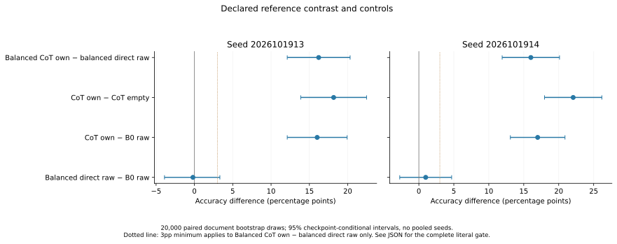
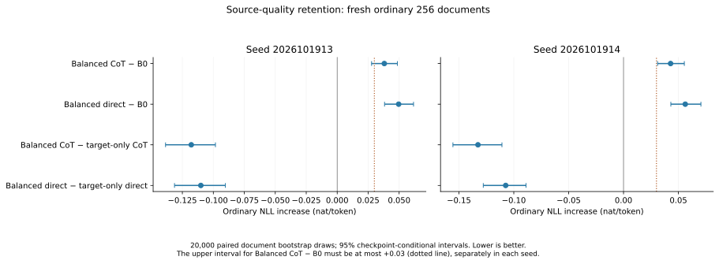

# Useful Thoughts on Trainium

The [document-QA study](validation/document_QA_v21_science_release_20261019.json)
is running: six fresh1.7B models compare direct answers,reasoning before answers,
and reasoning after a supervised answer stop. Two data-order seeds share2,048
training documents;512 evidence-disjoint questions and256 ordinary pages are fixed.
Strong conventional-CoT controls can win. **No QA capability result is available yet.**


Controlled experiments on whether self-generated intermediate computation improves
language-model predictions. Actual Qwen3-1.7B-Base, verified real mathematical
documents, and AWS Trainium. Official TEST remains unused.

**Latest result: a large arithmetic gain survives source-text regularization,
but the declared ordinary-prediction bound still fails.** Generated calculations
score **434/512 and 439/512**, versus **351/512 and 357/512** for matched direct
training. Ordinary NLL remains **0.038/0.043 nat per token worse than B0**.
The source loss removes about 76% of the target-only models' regression on this
same panel. This is useful progress with a remaining cost, not a combined pass.

## Completed source-balanced study

Four fresh models trained on the same 5,120 FineMath documents, with two seeds,
320 updates and two passes each. Each example combines 0.5 mean source-prefix CE
and 0.5 mean task CE. The task is either direct continuation or verified full
calculation followed by continuation. Terminal checkpoints are primary.

The new 512-document arithmetic panel excludes training and prior-panel documents
and exact ordered arithmetic ASTs. The ordinary 256-document panel is separate.
All models below were evaluated on these same new panels.

| Model / inference path | Seed1913 correct /512 | Seed1914 correct /512 |
|---|---:|---:|
| Unchanged B0, raw (shared) |352|352|
| Source-balanced direct, raw |351|357|
| Source-balanced CoT, raw |350|349|
| Source-balanced CoT, empty format |341|326|
| **Source-balanced CoT, generated calculation** |**434**|**439**|
| Source-balanced CoT, unrelated calculation |158|156|
| Source-balanced CoT, supplied exact trace |455|465|
| Earlier target-only CoT, generated calculation |442|433|
| Earlier prior-calculation CPT, generated calculation |418|408|

Generated computation beats matched direct training by **16.2 percentage points
[12.1,20.3]** and **16.0 [11.9,20.1]**. Matching empty-format and B0 contrasts
also have positive intervals. Both declared arithmetic gates pass.

The declared quality gate requires the upper 95% interval on ordinary NLL
regression versus B0 to be at most **+0.03 nat/token**, separately in each seed:

| Ordinary NLL increase versus shared B0 | Seed1913 | Seed1914 |
|---|---:|---:|
| Earlier target-only CoT, rescored here |+0.1558|+0.1755|
| Source-balanced CoT |+0.0380 [0.0277,0.0486]|+0.0429 [0.0310,0.0554]|
| Source-balanced direct |+0.0496|+0.0563|

**The quality gate fails in both seeds, so the combined gate fails.** Arithmetic
accuracy relative to the earlier target-only CoT varies by seed; its paired
intervals include zero. The point estimate of ordinary-NLL regression is reduced
by 75.6% in both seeds. That reduction is measured against the old models on the
same new panel, not by comparing different development sets.





## What this establishes and costs

The benefit is largely numerical: 80/77 of the net 83/82 extra correct answers
occur where both outputs already pass the parser. This descriptive accounting
retains the original 512-item denominator. CoT-own has 46/40 unsupported outputs
and 0/1 format errors; direct-raw has 46/43 unsupported outputs. Every failure stays.
There are zero execution errors across all 28,160 fixed answer attempts.

CoT notes average 34.1/34.5 sampled actions, with 0/2 capped and no empty notes.
Answers have a 32-action cap; **all source-CoT answers reach it**. The frozen
endpoint certifies the complete leading scalar, not a complete QA response.
Given reader-closing tokens are counted separately from generated actions.

Full16-token likelihood improves over matched direct training by 0.728/0.704 nats,
but remains 0.470/0.604 nats below B0. Raw arithmetic accuracy does not improve
clearly over the matched direct control. Raw ordinary NLL improves over that
control by 0.012/0.013 nat/token, while both remain worse than B0.
These are distinct training and inference endpoints.

Both arms see 4,489,846 source labels per seed; task labels differ:
163,840 direct versus512,900 CoT. Loss weights are not gradient-norm shares.
Training uses BF16 parameters/gradients with FP32 masters and Adam, one ZeRO
reduction owner, batch 32 and width 640. Four measured loops use 4.657 physical
device-hours including saves, excluding qualification, preparation and evaluation.
Inference timings come from concurrent FP32 jobs, not a controlled serving test.

This is a supervised arithmetic reference. Pattern overlap and pretraining
exposure remain possible. The study uses one frozen inference format; optimizing
the base CoT prompt remains untested. It does not establish spontaneous thought
emergence, broad reasoning improvement or unconditional pretraining benefit.

## Evidence and current direction

The [complete report](validation/real_source_balanced_v17_complete_20261019.json)
links 45 compressed original payloads: **28,160 answers / 5,632 notes / 30,976 likelihood rows**.
It includes all modes, numerical components, costs, 20,000 paired document
bootstrap draws per contrast, and the unchanged literal gates. Seeds are separate;
intervals are checkpoint-conditional and unadjusted.

The [artifact directory](validation/real_source_balanced_v17_complete_20261019/)
contains three checked figures, all-mode CSVs, 14 disclosed examples, exact
CPU/native parity arrays and the independent readout check. Original outputs and
current derived artifacts passed EBS readback protection. All original full
checkpoints remain on NVMe; EBS retains every terminal model and the latest full
optimizer state. See [checkpoint protection](docs/CHECKPOINT_BACKUP.md).

The next question is broader document reasoning, with the same distinction
between training benefit and extra-inference benefit. TRAIN-only MuSiQue data,
[V21 CPU preparation](validation/document_QA_v21_CPU_readiness_20261019.json) now freezes
2,048 training and512 held questions with disjoint supporting text/pages and
original seed-question IDs. All passages remain; all6,144 native supervised views
fit. Actual longer-context backward/save/restart qualification is active;
the document science study and its fixed evaluation are now released after actual
qualification. No RL or8B launch follows from V17.
See the [prospective QA comparison](validation/document_QA_v21_design_20261019.json),
short [current queue](NEXT_STEPS.md) and [proof ladder](docs/RESEARCH_ROADMAP.md).

Earlier results remain available:

- [V15 target-only SFT](validation/real_target_sft_v15_complete_20261019.json):
  positive arithmetic reference, with substantial ordinary-NLL regression.
- [V10 source-matched raw/prior/post CPT](validation/real_trace_cpt_v10_complete_20261019.json):
  both primary full-span gates fail; its separately frozen scalar secondary helps.
- [Bounded variable-depth repair](validation/variable_depth_writer_v11_complete_20261019.json):
  fixes much of the measured stopping shortcut; broader split rescue remains closed.
- [Two-seed split comparison](validation/partial_state_v7_matched5120_complete_20261018.json):
  full CoT wins the practical comparison.
- [Archived experiment record](docs/EXPERIMENT_HISTORY_20261019.md):
  earlier tables, negative results, controls and interpretation limits.

## Code and reproduction

One [causal training engine](train/partial_state_driver.py) serves explicit
experiment identities. [Source-balanced packing](train/real_source_balanced_packing.py),
[prefix-only generation](train/real_trace_notes.py),
[scalar evaluation](train/real_trace_answers.py), and
[full-span scoring](train/real_trace_cpu_scores.py) expose their masks and provenance.

Production V17 snapshots remain frozen at training
[37028a1](https://github.com/dario-fumarola/useful-thoughts-trainium/commit/37028a1)
and evaluation
[c9b399b](https://github.com/dario-fumarola/useful-thoughts-trainium/commit/c9b399b).
`main` integrates their code with the document-QA preparation;1,742 CPU tests plus smoke and
compile checks pass. Use each report's exact source hashes and protocols for
reproduction. A combined source snapshot needs separate hardware qualification.

```bash
bash scripts/run_checks.sh
```

Use a compatible installed environment and adapt local paths in scripts/env.sh.
Weights, raw corpora, credentials, caches and full checkpoints remain outside Git.
[START_HERE.md](START_HERE.md) and the [handoff](docs/AGENT_HANDOFF.md) describe the
working environment. Original authorship and third-party notices remain in
[NOTICE.md](NOTICE.md); public availability assigns no new license to historical material.
