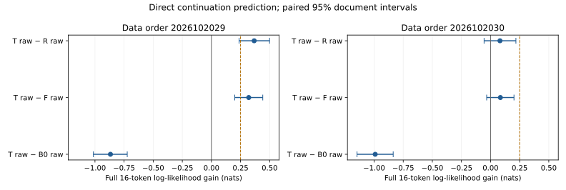
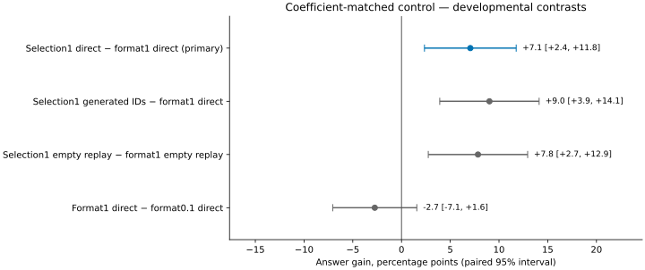
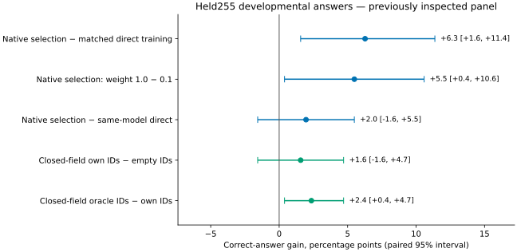
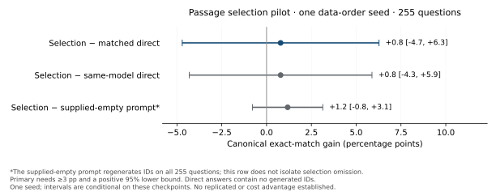
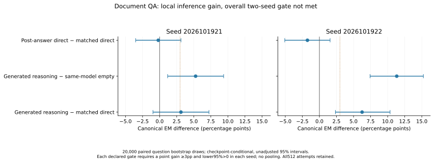

# Useful Thoughts on Trainium

**V30 closes the current predictive-reward branch without RL.** On256 fresh TRAIN
documents, hindsight best-of-eight calculations gain only **+0.082 nats** over the
same reader's raw full16 prediction (interval spans zero), and remain **−1.083 nats
below unchanged B0**. Correct calculations rank better on25 mixed documents, but
that is below the frozen32-document alignment requirement. Numerical gain again
comes with a prose-prediction cost. [Complete report](validation/candidate_utility_v30_complete_20261021/REPORT.md).
All2,304 attempts/3,840 scores and the fixed gates are preserved; independent
context/HF checks and model-free public numerical replay pass. No further model
run is queued. [Public evidence release](https://github.com/dario-fumarola/useful-thoughts-trainium/releases/tag/v30-candidate-utility-20261021)
has three assets, all fully downloaded and hash-verified without authentication.
V29's result below remains unchanged.

**V29 is complete: generated computation improves numerical completions, but the
primary direct-prediction criterion fails. Ordinary FineMath retention meets the
declared full-window target with a measurable regression.**

V30 has completed that candidate/reward diagnostic; its failed result above is
final. The [CPU-only mechanism proposal](docs/CAUSAL_READER_PROPOSAL.md) specifies
an unchanged B0 reference and a causal learned gate, with explicit learning and
control comparisons. Its conservative pointwise-capped variant is rejected by
a saved-score upper bound. Without that cap, the original greedy scores admit a
2.063-nat tokenwise hindsight bound; prospective recovery is untested. The revised
variant remains unexecuted. No further model calls, head learning, training or RL
are released. The [raw-control audit](validation/real_cpt_v29_raw_objective_audit_20261021.json)
confirms that V29's raw arm reweights continuations; the source review does not
identify why fresh-document prediction regressed.

Six fresh Qwen3-1.7B-Base models train on the same 20,480 real source windows over
two passes. Raw, empty-format and verified-computation arms share identical clean
LM supervision; two data orders share the original base initialization. Held
panels contain 768 calculation and 4,096 ordinary documents. Official TEST is unopened.

| Direct full 16-token likelihood contrast | Order 2026102029, nats [95% CI] | Order 2026102030, nats [95% CI] |
|---|---:|---:|
| Computation − raw training |+0.367 [0.238,0.499]|+0.081 [−0.056,0.218]|
| Computation − format training |+0.320 [0.200,0.441]|+0.084 [−0.033,0.201]|
| Computation − untouched base |**−0.867 [−1.014,−0.723]**|**−0.991 [−1.147,−0.836]**|

The trained-control criterion passes only in the first order; the absolute-base
criterion fails in both. **Overall CPT criterion: fail.** Conditional paired
intervals do not establish robustness across training runs.

The separately declared numerical-completion secondary is positive:

| Initial scalar correct / 768 | Order 1 | Order 2 |
|---|---:|---:|
| Untouched base, raw |510|510|
| Raw-trained, raw |500|502|
| Format-trained, raw |466|482|
| Computation-trained, raw |502|493|
| Computation-trained, empty |491|484|
| **Computation-trained, generated work** |**643**|**652**|

Generated work versus matched raw training gives+18.6pp[15.2,22.1] and
+19.5pp[16.1,23.0]. These are initial source-number completions under a fixed,
conservative parser, not QA scores or complete-document accuracy. All 1,536
computation own-path readers hit their 32-action cap; valid initial values can
precede that cap. Work itself stops naturally in 768/768 and 767/768 attempts.
Unsupported outputs and every original attempt remain in the denominator.

The same-model own-minus-raw full 16 likelihood is−0.131 / +0.111 nats, with both
intervals crossing zero. Numeral gains are offset by worse surrounding-text
prediction. The separate inference-likelihood gate fails; scalar gains do not
replace it. Correct supplied traces contain the answer and are plumbing controls.

Ordinary full 527 NLL costs versus B0 are+0.02110[0.01997,0.02225] and
+0.02087[0.01973,0.02204], meeting the declared +0.03 upper-bound target.
The final 16-token slice regresses more: +0.04159 / +0.04045. All trained arms remain
worse than B0. This is FineMath retention, not broad-language improvement.

- [Complete result, costs and limitations](validation/real_cpt_scaffold_v29_complete_20261020/REPORT.md)
- [Original primary readout](validation/real_cpt_scaffold_v29_complete_20261020/readout.json)
- [All scalar pairs and error counts](validation/real_cpt_scaffold_v29_complete_20261020/scalar-paired.json)
- [Ordinary continuation-slice analysis](validation/real_cpt_scaffold_v29_complete_20261020/ordinary-suffix16.json)
- [Eight outcome-independent examples](validation/real_cpt_scaffold_v29_complete_20261020/fixed-eight-examples.json)
- [Independent context/statistical/98HF checks](validation/real_cpt_scaffold_v29_complete_20261020/independent-check.json)
- [Actual extracted-archive statistical replay](validation/real_cpt_scaffold_v29_complete_20261020/public-replay.json)
- [Public evidence and standalone replay package](https://github.com/dario-fumarola/useful-thoughts-trainium/releases/tag/v29-real-continuation-cpt-20261020)
- [All 12 public assets verified by full download](validation/real_cpt_scaffold_v29_public_release_20261020.json)

All 28 evaluation groups / 49 workers close successfully: 60,928 likelihood rows,
15,626,240 token scores and 21,504 generation attempts. Science reservations are
28.427 training + 9.401 evaluation chip-hours, excluding qualifications and CPU work.
Full token scores/generated outputs are preserved; public source arrays are
projected to hashes while full original source rows remain local. No model or
optimizer weights are in Git. This is supervised, curated computation—not
internalization, autonomous discovery or a general pretraining win.

## Fixed positive control: V28

The [completed permutation study](validation/permutation_program_v28_complete_20261020/REPORT.md)
solves 18,432/18,432 and 18,430/18,432 fresh compositions at covered lengths by
generating verified states. Direct-answer transfer and longer execution fail;
its task-only recipe severely degrades ordinary prediction. Supplied pauses run
in parallel prefill and are not matched autoregressive compute. It remains a
fixed positive control, not a checkpoint to extend or initialize from.
[Full synthetic evidence and portable replay](https://github.com/dario-fumarola/useful-thoughts-trainium/releases/tag/v28-controlled-computation-20261020)
are public. Earlier document-QA training-side evidence below stays developmental.

## Latest matched control (V26)

One fresh empty-format control uses the same auxiliary weight1.0, TRAIN2048,
data order, four passes,256 updates, source/answer coefficients and numerical
worker as the completed selector. Terminal checkpoints are primary.

| Model / native answer path | Correct /255 |
|---|---:|
| Earlier format training, weight0.1, direct |127|
| Matched format training, weight1.0, direct |120|
| Selection training, weight1.0, direct |138|
| Selection training, weight1.0, generated IDs |143|

The primary **direct-answer** gain is **+7.1pp [2.4,11.8]**, passing the declared
developmental criterion. Closed-empty answer replay gives+7.8pp[2.7,12.9].
Increasing format weight alone changes127→120 (−2.7pp[−7.1,1.6]); the stronger
historical direct control therefore remains relevant. Selection1 direct versus
that control is still the earlier+4.3pp[−0.4,9.4].

This is one data-order seed on255 questions inspected before choosing the
intervention. The intervals are conditional and unadjusted: this is promising
training-recipe evidence, not fresh confirmation or autonomous computation.
Generating IDs adds only the previously reported+2.0pp[−1.6,5.5] over the same
selector's direct path. Equal scalar coefficients do not match gradient magnitudes,
label counts or information; all20 passages remain visible.

Selection training retains ordinary prediction better: NLL2.011 versus2.088 for
the matched format model. Both remain worse than untouched B0 (1.945).
All510 new answer attempts and256 ordinary likelihood cases close without errors,
caps or unsupported answers; both no-ID controls remain clean. Independent token,
parser, calibration, count and paired-bootstrap checks pass. Science uses2.111
reserved chip-hours; disposable qualification uses0.342 separately. Original full
checkpoints,269 raw/source files and58 public artifacts are protected on the same instance.

- [Complete readout and limits](validation/document_evidence_format_weight_v26_complete_20261020.json)
- [Fixed examples, including every comparison](validation/document_evidence_format_weight_v26_complete_20261020/fixed-eight-examples.json)
- [Ordinary-text cost](validation/document_evidence_format_weight_v26_complete_20261020/ordinary-NLL-cost.svg)
- [Training protocol and hardware qualification](validation/document_evidence_format_weight_v26_science_release_20261019.json)

The [fresh-source feasibility check](validation/document_evidence_v27_confirmation_feasibility_20261020.json)
finds insufficient independent questions under the existing exclusions:875 clean
DEV items,333 evidence groups, independent-count upper614 versus the planned1024.
No smaller confirmation is released; V26 remains developmental. The next mechanism
step is verified variable-depth computation with a trained extra-compute control.
No coefficient sweep, larger model or RL escalation follows from this result.
The [research goal](docs/RESEARCH_ROADMAP.md) remains reusable computation that
becomes autonomous and can eventually be internalized.

## Latest coefficient ablation (V25)

One fresh model changes the selection-loss weight from **0.1 to 1.0**. Documents,
data order, four passes over TRAIN2048, 256 updates, source/final-answer weights
0.5/0.5, optimizer and numerical worker stay fixed. The completed 0.1 model is
reused as control. Terminal checkpoints are primary.

| TRAIN support count | Exact sets, weight 0.1 | Exact sets, weight 1.0 |
|---|---:|---:|
| Two |117/128|124/128|
| Three |59/96|64/96|
| Four, descriptive |12/32|15/32|

The primary fitting gate **fails**: three-support agreement is 66.7%, below 90%,
and its paired improvement interval crosses zero. All 256 TRAIN answers are
correct, which does not establish correct support selection or generalization.
Support annotations contain known entity/relation problems; exact matching is
not semantic verification. Every reader still sees all 20 passages.

On the **same previously inspected held255 panel**, canonical whole-answer scores are:

| Model / path | Correct /255 |
|---|---:|
| Earlier direct training (auxiliary weight 0.1), native direct |127|
| Earlier selection training (weight 0.1), native selection |129|
| New selection training (weight 1.0), native direct |138|
| New selection training, native generated IDs |143|
| New model, closed empty field and prefilled answer header |139|
| New model, own-ID answer replay |143|
| New model, annotated-ID answer replay |149|

New native selection beats the earlier direct recipe by **6.3pp [1.6,11.4]**.
However, generating IDs adds only **2.0pp [−1.6,5.5]** over the new model's direct
answers. Matched own-ID versus empty-ID answer replay adds **1.6pp [−1.6,4.7]**.
The direct-only training contrast is +4.3pp [−0.4,9.4]. These are conditional,
unadjusted paired intervals from one data-order seed and a reused development
panel, not fresh confirmation. The historical direct control retains auxiliary
weight0.1; V26 above supplies the completed coefficient-matched format control.

Held exact-set agreement improves to 169/255 from 132/255, concentrated in
two-support questions. Three-support sets are still only 9/46, and all four
four-support questions remain incomplete. Annotation agreement is not the goal
by itself: the three-support reader answers 31/46 with either own or annotated IDs.

Ordinary256 NLL remains **+0.067 nats/token worse than B0**, but is 0.069 better
than the earlier selector. This is a smaller specialization cost, not broad LM
improvement. Native selection uses 17.16 actions/question versus 7.64 for direct
answers, about 2.25×. Timing is not a controlled serving benchmark.

All 1,531 generation attempts and 256 likelihood rows are complete, independently
checked and protected. Answer fields have no errors, caps or unsupported outputs;
one unsupported held selection uses the declared empty replay fallback.
The repaired empty control regenerates no IDs. Science used 2.232 reserved
chip-hours; disposable hardware qualification used 1.272 separately.
All original full checkpoints remain; the terminal model/latest full state and
445 original readout/source files have verified same-instance backups.

- [Complete readout and limits](validation/document_evidence_weight_v25_complete_20261019.json)
- [Independent held check](validation/document_evidence_weight_v25_complete_20261019/held-independent-check.json)
- [Same eight fixed examples](validation/document_evidence_weight_v25_complete_20261019/fixed-eight-examples.json)
- [Selection breakdown](validation/document_evidence_weight_v25_complete_20261019/held-selection-descriptive.json)
- [Ordinary prediction cost](validation/document_evidence_weight_v25_complete_20261019/ordinary-NLL-cost.svg)

The coefficient-only fitting repair is closed. V26 above finds a developmental
content-training advantage over matched format1.0. Its one-seed, reused-panel
result needs fresh confirmation; it does not change this failed fitting gate.

## Earlier passage-selection pilot (V23)

Two fresh Qwen3-1.7B-Base models, one data-order seed, the same TRAIN2048 questions
and four passes. Source, final-answer labels and their explicit loss coefficients
match; pointer supervision has its own loss. Terminal256 is primary. The fresh
255-question panel is mostly two-hop; official DEV/TEST remain unopened.

| Model / path | Correct /255 |
|---|---:|
| Matched direct training, direct answer |127|
| Matched direct training, empty-field response |126|
| Selection training, direct answer |127|
| Selection training, generated IDs |129|
| Selection training, supplied-empty prompt† |126|
| Selection training, annotated support IDs |155|

The primary gain is **+0.8pp [−4.7,+6.3]**, below the declared three-point/positive
lower-bound gate. Selection versus the same model's direct path is also
+0.8pp [−4.3,+5.9]. All answer fields are complete, all255 generated selections
are syntactically valid, and no generation is capped. Replication is not released.
A failed gate does not establish that the true effect is zero.

†The supplied-empty prompt generates a new ID list on **255/255** questions.
It does not isolate selection omission. Its original score is preserved; both
models' direct paths genuinely generate no IDs. This caveat does not change
the failed primary or same-model direct comparison.

The reader can use supplied selections: annotated IDs improve it by
**10.2pp [6.3,14.5]** over its own generated IDs, without adding answer text.
Generated sets exactly match the annotation on132/255 questions; mean support
recall is77.0%. In a posthoc split, exact-set selections gain14 answers relative
to direct answering, while other selections lose12. These groups are descriptive,
not causal estimates or semantic verification of the annotations.

Canonical pointer replay is more useful than donor IDs in likelihood
(+0.845 nats [0.326,1.373]) but worse than a genuinely empty replay
(−0.731 [−1.192,−0.299]). These are fixed-context likelihood diagnostics,
not native-generation likelihood or calibration. Generated selection uses
17.4 actions/question versus7.41 for direct training, about2.35×. Ordinary-text
NLL is still worse than untouched B0 by0.135 nats/token, despite a small advantage
over the matched control. No broad pretraining or ordinary-CoT superiority is shown.

All1,530 native attempts and3,062 likelihood rows are complete, independently
checked and protected. The original pre-held calibration-file failure and its
narrow IO repair are preserved; models, observations and gates are unchanged.
Successful training/evaluation used4.723 reserved chip-hours, plus0.062 for that
failed calibration attempt; hardware qualification is separate. Concurrent timings
are not a controlled serving-latency comparison.

- [Complete primary report](validation/document_evidence_plan_v23_pilot_complete_20261019.json)
- [Stored-output and empty-control diagnosis](validation/document_evidence_plan_v23_pilot_complete_20261019/stored-selection-and-empty-prefix-diagnosis.json)
- [Fixed examples](validation/document_evidence_plan_v23_pilot_complete_20261019/fixed-hash-eight-examples.json)
- [Independent check](validation/document_evidence_plan_v23_pilot_complete_20261019/independent-readout-check.json)

## Earlier frozen selector fitting (V24)

A frozen-model check on a fixed hash sample of the original training questions
finds incomplete support-set fitting, especially beyond two passages:

| Annotated support count | Exact selected sets | Correct TRAIN answers |
|---|---:|---:|
| Two |117/128 (91.4%)|127/128|
| Three |59/96 (61.5%)|96/96|
| Four |12/32 (37.5%)|32/32|

The predeclared fitting target fails on three-support questions. All256 answer
fields complete without errors or caps; one selection has duplicate IDs.
There are no identical rendered TRAIN inputs with conflicting support labels.
Twenty of the three-support outputs omit a required ID while choosing only
annotated supports. These are annotation-agreement diagnostics, not semantic
verification. Near-perfect TRAIN answers do not establish evidence selection or
generalization; the oversampled TRAIN panel cannot be pooled with held questions.

The check used the unchanged terminal model and prompt, no parameter updates,
and0.048 reserved chip-hours. Raw outputs, fixed examples and independent checks
are saved in the [complete fitting report](validation/document_selector_fit_v24_complete_20261019.json).
V25 above tests one supervision-allocation repair of this gap.

## Earlier document-QA comparison

**The document-QA study is complete: generated reasoning helps the same trained
model, but its advantage over matched direct training does not pass the declared
two-seed gate. Post-answer reasoning supervision shows no direct-accuracy improvement here.**

Six fresh models, two data-order seeds, the same 2,048 training questions and four
passes (256 updates). Every example combines 0.5 mean source CE over 256 fixed
source positions and 0.5 mean task CE. Direct training predicts the answer;
prior training mixes direct answers with full-trace CoT; post training mixes direct
answers with reasoning after an answer stop. Task-label counts differ by arm.
Terminal checkpoints are primary; the held panel has 512 questions with disjoint
supporting evidence, pages and original question identities relative to training.

| Model / path | Seed1921 correct /512 | Seed1922 correct /512 |
|---|---:|---:|
| Unchanged B0, fixed-demo conventional CoT (shared) |92|92|
| Matched direct training, direct answer |201|195|
| Prior training, direct answer |201|180|
| Prior training, empty reasoning format |190|169|
| **Prior training, generated reasoning** |**217**|**227**|
| Prior training, fixed-demo conventional CoT (secondary) |224|222|
| Post-answer training, direct answer |200|186|

Canonical whole-answer EM is primary; all failures remain in denominators.
Canonical token F1 and separately attributed answer-alias metrics are also saved.
Generated reasoning's F1 is 0.509/0.533 versus 0.490/0.470 for matched direct training.
Its attributed-alias EM is 238/512 and 247/512; these do not replace canonical scores.

| Predeclared contrast | Seed1921 gain, pp [95% CI] | Seed1922 gain, pp [95% CI] |
|---|---:|---:|
| Post direct − matched direct |−0.2 [−3.5,3.1]|−1.8 [−5.1,1.6]|
| Generated reasoning − same-model empty |+5.3 [1.2,9.4]|+11.3 [7.4,15.2]|
| Generated reasoning − matched direct |+3.1 [−1.0,7.2]|+6.3 [2.3,10.4]|

The gate requires a point gain of at least 3pp and a positive paired lower bound
in **each** seed. The overall inference and practical-value gates therefore fail;
the post-answer training gate also fails. The local reasoning-versus-empty gain
is positive in both seeds, entirely among pairs with complete answer fields.
Intervals use 20,000 paired question bootstrap draws, conditional on each checkpoint,
without pooling seeds or adjusting intervals for multiple comparisons.

## What the controls and outputs show

The ordinary-trained model's fixed-demo CoT path scores only **1/512 in each seed**,
with 510 unsupported outputs each. It usually fails the required answer format.
Large gains over that degraded path are not evidence of a strong CoT baseline win.
A labelled posthoc rule—use the anchored final field, otherwise the first complete
line—recovers191/182 on those same outputs, below native direct201/195. It changes
no primary score or gate; a future parser must be fixed before fresh evaluation.
All paths and format counts remain in the [complete tables](validation/document_QA_v21_complete_20261019/all-answer-failures-costs.csv).

Prior-model accuracy falls to 11/23 without documents and 148/144 when one annotated
bridge paragraph is removed. Own-note replay scores 217/227 versus 11/33 with an
unrelated note. These are evidence/content diagnostics, not perfect causal isolation.
Supplied oracle traces score 507/512 and 512/512, but contain the root answer.

The additional gain is concentrated in two-hop questions. Three- and four-hop
cells show no consistent advantage; there are only 104/23 such questions. Stored
traces also contain wrong intermediate facts and citations. Some correct final
answers follow visibly incorrect intermediate claims. Literal presence of an
answer in a cited paragraph does not establish that the stated relation is supported.
One fixed example’s gold citation contains “Ohio” in a military unit name without
stating the asked place-of-death relation. Teacher grounding also needs inspection.

Post-answer training does improve gold-answer log likelihood over matched direct
training by 0.38/0.93 nats, with positive paired intervals, despite no direct-accuracy
gain. This secondary predictive result does not pass the declared accuracy gate.

Accuracy and likelihood disagree: own notes reduce gold-answer span likelihood
versus empty by **7.34/7.75 nats**, mostly in answer content rather than EOS.
Correct canonical answers have positive average gains, while other written claims
can make the gold surface much less likely. This does not justify restarting the
old likelihood-reward RL recipe. Exact-match and exact-surface likelihood also
penalize valid alternative phrasing; alias and F1 diagnostics remain separate.

## Cost, limits and reproducibility

Generated reasoning uses 57.4/56.3 actions per question versus 5.37/5.37 for matched
direct training. Observed median execution times are about 4.96/4.92 versus 1.03/1.03
seconds under concurrent jobs; this is not a controlled serving-latency benchmark.
Prior training's ordinary-page NLL is 0.097/0.110 nat/token worse than B0, although
it is better than matched direct training by 0.036/0.020. This is specialization
with a measured cost, not broad language-model improvement.

All **20,992 generation attempts and 19,712 likelihood rows** completed with zero
execution errors. Raw outputs, unsupported cases, native targets, examples and
analysis sources are preserved and read back on EBS. All six terminal model files
and a complete optimizer recovery state are protected; EBS is same-instance.
Numerical parity establishes execution integrity, not learning. A derived checker
repair replaced exact FP64 summary equality with a 1e-10 comparison after an
observed 2e-12 reduction difference; original scientific and numerical gates,
outputs, metrics, intervals and the primary report hash remain unchanged.

- [Complete result and literal gates](validation/document_QA_v21_complete_20261019.json)
- [Frozen design and release](validation/document_QA_v21_science_release_20261019.json)
- [Actual training and checkpoint evidence](validation/document_QA_v21_training_20261019.json)
- [Independent readout check](validation/document_QA_v21_complete_20261019/independent-readout-check.json)
- [Fixed-hash examples](validation/document_QA_v21_complete_20261019/fixed-hash-eight-examples.json)
- [Format, alias and hop diagnostics](validation/document_QA_v21_complete_20261019/format-alias-hop-inspection.json)
- [Posthoc serialization diagnostic](validation/document_QA_v21_complete_20261019/posthoc-serialization-diagnostic.json)
- [Stored-trace diagnosis](validation/document_QA_v21_complete_20261019/stored-trace-content-diagnosis.json)
- [Resource accounting](validation/document_QA_v21_complete_20261019/resource-accounting.json)
- [Earlier results, including V17's unchanged failed quality gate](docs/EXPERIMENT_HISTORY_20261019.md)
- [Current queue](NEXT_STEPS.md)

The follow-up [TRAIN-only audit](validation/document_QA_v22_TRAIN_audit_20261019.json)
examines 24 questions and 72 cited relations: 57 are locally supported, eight have
insufficient citations, six are ambiguous, and one has a temporal contradiction.
Four questions switch between different counties or cities sharing a name.
All 72 citations match the original source annotations. This is an exploratory
single-agent review, not independent adjudication or a population error estimate;
insufficient citations do not establish that the answers themselves are false.

The completed passage-selection pilot above repaired final-answer weighting and
answer serialization, and removed supervised intermediate factual claims.
Its [training/state qualification](validation/document_evidence_plan_v23_training_20261019.json)
and [decoder qualification](validation/document_evidence_plan_v23_decode_qualification_20261019.json)
are execution evidence. Its failed capability gate remains the allocation decision;
no replication, RL escalation or model-size jump follows from the engineering passes.
