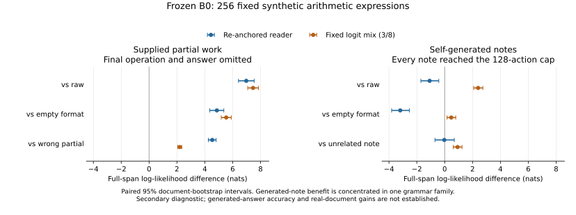

# Useful Thoughts on Trainium

Controlled experiments on whether self-generated intermediate text improves
language-model capability. This repository contains the experiment specification,
implementation, checks, and research context for a pretrained-model comparison
on AWS Trainium.

## Current finding

**Useful self-generated thoughts have not been established on real-document DEV
or GSM8K.** Supplied intermediate work helps on controlled arithmetic. A larger
future-aware teacher batch also supplies enough real training labels. The first
matched supervised writer/reader and source-only runs were interrupted by host
RAM exhaustion before their terminal checkpoints; no trained comparison is available yet.

Fresh B0 notes give these likelihood changes with the fixed mixed reader:

| Cohort, 256 documents each | Own−raw | Own−empty | Own−unrelated |
|---|---:|---:|---:|
| Real arithmetic |−.673 [−.837,−.508]|−.575 [−.727,−.420]|−.099 [−.239,.042]|
| Real general text |−.847 [−1.035,−.651]|−.633 [−.785,−.479]|−.369 [−.535,−.202]|
| Controlled synthetic arithmetic |+2.400 [2.078,2.738]|+.473 [.167,.794]|+.925 [.616,1.246]|

Values are nats with paired document-bootstrap 95% intervals, conditional on B0.
The real panels score the next 16 natural tokens; the synthetic panel scores the
complete signed integer and closing newline. Each comparison retains all attempts,
empty notes and errors. Fixed mixing combines raw and re-anchored full logits with
weight 3/8, fitted on separate TRAIN data. Ordinary re-anchoring hurts generated-note
likelihood on all three panels. Complete results and examples:
[real arithmetic](validation/postorder_held256_B0_20261018.json) ·
[real general text](validation/general_note_held256_B0_20261018.json) ·
[synthetic arithmetic](validation/controlled_arithmetic_DEV256_B0_20261018.json).

On the synthetic panel, **supplied correct partial work helps without revealing
the final operation or answer**. Ordinary re-anchoring gains +6.978 [6.417,7.544]
over raw, +4.866 [4.357,5.366] over empty, and +4.535 [4.253,4.813] over a wrong
intermediate result. This supports reader use of intermediate values, without
establishing verification or free-answer accuracy. Generated-note gains with fixed
mixing are concentrated in `(a+b)*(c-d)`; the other three families have negative
own−empty means. All 256 generated notes hit the 128-action cap. Unrelated donors
cross grammar families, with equal 128-token lengths; their contrast does not
isolate calculation from expression restatement. This secondary result does not
replace the real endpoints or release RL.



The GSM8K TRAIN512 B0 reference is also negative:

| Mode | Strict correct /512 | Unsupported /512 |
|---|---:|---:|
| Direct calculation |429|11|
| Empty thought format |433|18|
| One generated thought |276|147|

Thought−empty is −30.66 percentage points [−35.74,−25.78]. Format and truncation
failures prevent interpreting this solely as an arithmetic change. All 1,536
outputs remain in the [complete result](validation/postorder_gsm8k_TRAIN512_B0_20261018.json).
The first 128 questions have known development outcomes; official TEST is unused.

The completed general TRAIN batch contains 24,576 future-aware teacher attempts
and 196,608 reader comparisons, with zero errors. Across the entire candidate pool,
fixed mixing gives teacher−raw +.831 [.788,.877], teacher−empty +1.009 [.967,1.053]
and teacher−unrelated +1.147 [1.105,1.190] nats. Ordinary re-anchoring still loses
2.840 [2.755,2.921] nats against raw. The strict filter found 8,964 eligible positives;
the first 5,120 in the frozen order form a separate warm-start dataset. Selected
positivity is true by construction. The labels retain 166 exact demonstration
imitations, and shorter future copying or paraphrase remains possible. These are
future-aware TRAIN labels, without evidence yet for a useful prefix-only writer.
[Complete results, fixed examples and all score vectors](validation/general_hindsight_filtered_TRAIN24576_20261018.json).
Actual native packing passes on isolated `general-sft-v5`; hardware qualification
and training remain pending. The earlier [256-document pilot](validation/general_hindsight_TRAIN256_20261018.json)
and negative [prefix-helper probe](validation/general_prefix_helper_20261018.json) remain available.

**Training interrupted by host OOM:** W reached 220/320 updates and C′ 119/320
before Linux exhausted host RAM around13:16UTC. Both step64 model-only snapshots
survived and are hash-verified on EBS; no resumable optimizer checkpoint survived.
[Incident, preserved models and complete run archives](validation/reader_learning_compound5120_host_OOM_20261018.json).
These attempts started from fresh B0, shared5,120real TRAIN documents and seed
order, and were planned for twoepochs/320updates. W learns note tokens, natural
continuation and raw source; C′ matches continuation weighting without notes.
Documents/updates match; tokens, gradient dose and compute differ.
[Original W launch](validation/reader_learning_compound5120_W_seed20261018_launch.json) ·
[Original C′ launch](validation/reader_learning_compound5120_Cprime_seed20261018_launch.json).
The320-step comparison remains incomplete. The preserved matched step64 models
will be evaluated explicitly as developmental checkpoints while host-memory growth
is investigated. They do not replace the terminal endpoint or permit resumption
without optimizer state. [Current queue](NEXT_STEPS.md) · [Experiment summaries](STATUS.md).

## What led here

- **A copying interface is qualified; arithmetic headroom is limited.** None of six
  ordinary interfaces passed the initial full-span oracle. The TRAIN-fitted fixed
  mixer passes general DEV256 (tax−.154, correct−raw+11.948, correct−corrupt+12.203
  nats), while the original arithmetic panel fails (+.641/.249 gains). General
  oracle notes copy the next16 tokens; they are not prefix-only thoughts. The
  original arithmetic number-only NLL is just .648 nat. DEV reuse makes this
  exploratory interface qualification.
  [Six-interface batch](validation/interface_target_copy_dev256x2_20261018.json) ·
  [Complete mixer fit and controls](validation/interface_scalar_mixer_dev256x2_20261018.json).
- **The initial symbolic filter failed its quota.** Only3,147/14,669 notes beat
  empty-format (21.45%); mean teacher−raw is−1.809nats including the closing boundary.
  The new compound5120 study explicitly teaches the reader as well as the writer,
  using verified compound equations selected without likelihood filtering. It does
  not declare the old filter passed.
  [Failed filter](validation/postorder_symbolic_frozen_reader_filter_20261018.json) ·
  [New design](validation/reader_learning_compound5120_design_20261018.json) ·
  [Data inventory](validation/reader_learning_compound5120_data_20261018.json).
- **Memory and recovery repairs are qualified.** FP32 model storage exhausted
  memory in W/C′. BF16 storage with FP32 masters completed three real updates per
  arm, and actual full-state recovery restored all32ranks and performed the next
  ordered update. Earlier numerical-reference and installed-optimizer validation
  failures remain preserved. These are execution checks, not capability results.
  [Hardware evidence](validation/useful_note_bf16_storage_hardware_20261018.json) ·
  [Recovery](validation/useful_note_state_recovery_002_20261018.json).
- **Nearby partial notes did not help.** The fixed TRAIN 256 / DEV 64 probe completed
  all 1,920 likelihood cells and 384 numeric paths. Correct−raw numeric likelihood
  was −1.351/−1.600 nats, both intervals negative. DEV correct/raw/empty/corrupt
  initial-scalar counts were 28/31/31/10 of 64, with unsupported 31/22/22/29.
  Eighteen corrupted outputs matched the changed whole value (one also matched
  the original partial): sensitivity existed without net assistance. These bounded
  parser scores exclude some correct multistep calculations; all paths remain saved.
  [Complete likelihood, generation and mechanism evidence](validation/finemath_arithmetic_near_lhs_reader_20261018.json) ·
  [Earlier prepend probe and parser limits](validation/finemath_arithmetic_reader_20261018.json).
- **Initial R study stopped.** Inserting the original thought format carried a
  large initial penalty: B0 DEV512 K1 raw −1.118, empty −7.361, own −11.203 nats.
  Own versus unrelated content was indistinguishable from zero. R1234 stopped
  after 63 updates; R5678 never launched. Both old C runs finished 256 updates.
  The original primary R/C comparison is incomplete.
  [B0 audit](validation/local_dev_B0_20261017.json) ·
  [R execution and preserved checkpoint](validation/science_R_seed1234_stopped_20261017.json).
- **Repairing format did not establish content utility.** Prepending notes
  reduced empty-format tax to approximately zero. On fixed TRAIN128, a
  future-selected best-of-16 tail gained +1.026 nats over empty, while the
  ordinary mean lost 1.072 nats. Oracle selection sees the target.
  [Interface probe](validation/prepend_reader_dev32_20261017.json) ·
  [TRAIN oracle](validation/candidate_prepend_train128_20261017.json) ·
  [DEV oracle](validation/candidate_oracle_dev32_cap256_20261017.json).
- **The first learning comparison was negative.** A 64-update note-cloning arm
  and a raw future16 CE control shared 77 documents and 512 ordered occurrences,
  with unequal labels and compute. Fresh DEV64 notes still hurt the unchanged
  reader: K16 own−empty B0 −1.101, raw −0.956, cloning −0.649 nats. The
  cloning-minus-control change was +0.307 [−0.209,+0.908]. Both terminal states
  are fully backed up. Reader adaptation also failed.
  [Three-arm result](validation/warmstart_dev64_three_arm_20261018.json) ·
  [Reader crosses](validation/warmstart_reader_cross_dev64_20261018.json).
- **Downstream checks also failed.** GSM8K TRAIN128 direct/empty/thought correct
  counts were B0 113/107/63, cloning 92/92/61, raw CE 56/112/76. Every thought
  mode lost to its own empty control. Raw direct had 59 format errors, so its
  score does not isolate arithmetic ability.
  [All nine conditions](validation/warmstart_gsm8k_train128_terminal64_20261018.json).
- **External partial calculations show limited assistance.** A separate TRAIN32
  pilot scored arithmetic-verified manual notes 30/32, empty 27/32, corrupted
  notes 5/32. All three added strict successes repaired answer formatting or
  avoided truncation; none corrected a wrong parsed number. Numeric likelihood
  improved +0.945 [0.258,1.591] nats. One manual note missed a purchasing
  discount despite correct arithmetic; its frozen note and score are unchanged.
  Local 4B notes included final answers. These are qualifications on assistance,
  not evidence of useful student computation.
  [Pilot](validation/gsm8k_calculation_train32_20261018.json) ·
  [Exhaustive posthoc mechanism panel and correction](validation/gsm8k_calculation_train32_mechanism_20261018.json).
- **Short self-generated notes also failed.** On known GSM8K TRAIN32 questions,
  unchanged B0 scored 86/128 sampled paths (67.2%), versus 24/32 (75%) for both
  direct calculation and generate-then-discard. Four paths estimate a single-note
  policy, never best-of-four or voting. Own−direct is −7.81pp [−18.75,+2.34];
  numeric likelihood also declines. All notes, failures and costs are retained.
  Equal token caps do not establish equal FLOPs or latency.
  [Complete self-note result](validation/gsm8k_self_note_train32_20261018.json).

All official final tests remain unused. Failures stay in denominators, controls
are reported alongside raw performance, and oracle results remain separate from
ordinary generated-note utility. Historical implementation and results remain
available in Git and the linked reports.

## Code and plan

| Path | Purpose |
|---|---|
| [configs/weekend.json](configs/weekend.json) | Original stopped experiment configuration |
| [docs/WEEKEND_PLAN.md](docs/WEEKEND_PLAN.md) | Original scientific design and interpretation |
| [train/computable_equations_supervised.py](train/computable_equations_supervised.py) | Verified real equations for supervised labels; future-aware curation |
| [train/interface_oracle_probe.py](train/interface_oracle_probe.py) | Complete six-interface full-span target-copy probe |
| [train/calculation_boundaries.py](train/calculation_boundaries.py) | Bounded exact-arithmetic parser and original stricter curator |
| [train/calculation_boundary_probe.py](train/calculation_boundary_probe.py) | Controlled reader feasibility and exact LHS reanchoring |
| [train/scalar_completion.py](train/scalar_completion.py) | Versioned initial-scalar boundaries; legacy scores remain preserved |
| [train/neuron_driver.py](train/neuron_driver.py) | Historical C/R qualification and driver |
| [train/neuron_backend.py](train/neuron_backend.py) | Causal cache, generation, scoring, and policy replay |
| [train/evaluate.py](train/evaluate.py) | Question-only, sharded math evaluation |
| [train/evaluate_likelihood.py](train/evaluate_likelihood.py) | ARC and full-target LAMBADA likelihood |
| [train/evaluate_local.py](train/evaluate_local.py) | Saved prefix-only notes, content controls, and crossed readers |
| [weekend_thinking/](weekend_thinking/) | Objective, data, checkpoint, and analysis primitives |
| [tests/](tests/) | CPU correctness checks; these do not certify hardware |
| [context/](context/) | Research context and evidence limits |
| [legacy/](legacy/) | Preserved historical source and results; not active launch instructions |

## Running checks

Use a compatible, already working Neuron environment for accelerator work.
Instance paths in `scripts/env.sh` are local conveniences; adapt them to your
own installation. Model weights and corpus acquisition are explicit actions.

```bash
bash scripts/run_checks.sh
```

The CPU checks require PyTorch, NumPy, pytest and a compatible Transformers
installation, and disable accidental XLA initialization. Accelerator qualification,
actual distributed updates, full-step timing, and checkpoint resumption are
separate requirements. Read [START_HERE.md](START_HERE.md) and
[docs/NEURON_IMPLEMENTATION.md](docs/NEURON_IMPLEMENTATION.md) before launching.

Host configuration, credentials, downloaded datasets, weights, compiler caches,
raw traces, and checkpoints remain outside Git under ignored local paths.
Small validation reports describe their provenance and limits.
Verified local checkpoint copies are described in
[CHECKPOINT_BACKUP.md](docs/CHECKPOINT_BACKUP.md).

Original authorship and third-party notices are preserved; see
[NOTICE.md](NOTICE.md). Public availability does not assign a new license to
historical material.
