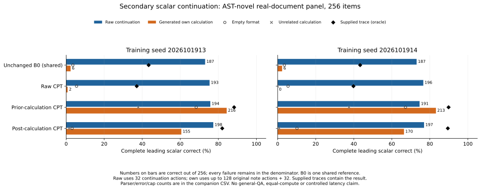
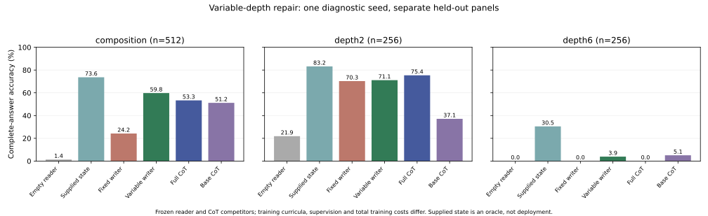
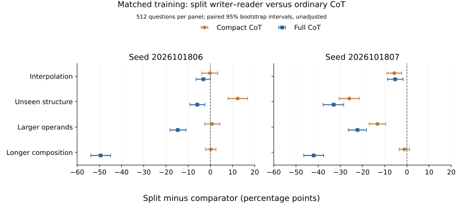

# Useful Thoughts on Trainium

Controlled experiments on whether self-generated intermediate computation improves
language-model predictions. Actual Qwen3-1.7B-Base, real mathematical documents,
and computation diagnostics run on AWS Trainium. Official TEST remains unused.
The [current proof ladder](docs/RESEARCH_ROADMAP.md) separates reader use,
prefix-only computation, actual student benefit, cost, and return to real text.

The completed mainline tests **single-model real-document training** on 5,120
FineMath documents, starting from the same base in three arms and two seeds.
The result is mixed: **generated calculations improve complete-number accuracy;
neither predeclared 16-token likelihood gate passes.** Training benefit without
extra thinking remains unestablished.

A [bounded follow-up](validation/real_target_sft_v15_design_20261019.json) now
compares direct-answer SFT with full-trace CoT SFT on the same training documents
and a fresh 384-document panel. Its [hardware recovery qualification](validation/real_target_sft_v15_hardware_20261019.json)
passes. All four fixed runs have completed 320 updates, and their
[training traces and terminal-state audit](validation/real_target_sft_v15_training_20261019.json)
are saved. The nine-model evaluation is active; capability results are pending.
This closes a supervised-baseline gap. The completed findings below remain unchanged.

## Latest completed study: single-model real-document computation

These are the terminal step-320 checkpoints, not selected intermediate models. The
primary panel contains 256 documents with ordered, exact-value arithmetic ASTs
absent from our training set; operation patterns can recur. Every number below
uses all 256 documents, including unsupported and failed outputs.

| Model / inference path | Seed1913 correct | Seed1914 correct |
|---|---:|---:|
| Unchanged B0, raw (shared reference) |187|187|
| Ordinary continuation training, raw |193|196|
| Prior-calculation training, raw |194|191|
| Prior-calculation training, empty |175|172|
| **Prior-calculation training, generated calculation** |**216**|**213**|
| Prior-calculation training, unrelated calculation |97|96|
| Prior-calculation training, supplied exact trace |226|230|
| Post-document calculation training, raw |198|197|

Generated calculations beat ordinary continuation training by **9.0 percentage
points [4.3,14.1]** and **6.6 [2.0,11.7]**, and beat their own empty controls by
16.0 points in each seed. There are 25/24 unsupported generated-path outputs,
versus 32/34 for the ordinary raw control (plus one format error in seed1913).
All failures remain in denominators; there are no execution errors. The
[complete category counts](validation/real_trace_cpt_v10_scalar_secondary_20261019/all-modes-accuracy-and-failures.csv)
include every model and control. This scalar endpoint was
[declared before trained capability review](validation/real_trace_cpt_v10_scalar_secondary_design_20261019.json)
and remains secondary.

| Primary full 16-token likelihood contrast (nats/span) | Seed1913 mean [95% CI] | Seed1914 mean [95% CI] |
|---|---:|---:|
| Post raw − ordinary-control raw |+0.012 [−0.039,+0.064]|+0.006 [−0.051,+0.065]|
| Prior generated − ordinary-control raw |+0.097 [−0.135,+0.329]|−0.139 [−0.425,+0.140]|
| Prior generated − same-model empty |+1.647 [+1.362,+1.939]|+1.095 [+0.770,+1.429]|
| Prior generated − unrelated |+2.646 [+2.246,+3.061]|+2.520 [+2.076,+2.974]|

Both declared gates require at least 0.25 nat gain and a positive interval lower
bound in each seed, with their additional controls. **Both fail.** The post arm
passes its ordinary-FineMath regression bound, but provides no clear training-only
gain. Raw CPT and post raw are each about 0.30 nat/span below unchanged B0 on the
arithmetic panel. Prior-generated versus B0 raw is −0.216 [−0.509,+0.076] and
−0.452 [−0.799,−0.113]. Thus the scalar improvement does not establish better
prediction of the full original continuation. Intervals are paired document
bootstraps conditional on each checkpoint; they do not quantify training-seed
uncertainty. The two seeds and the legacy panel are never pooled.

A [post-hoc partition of the same saved scores](validation/real_trace_v10_token_partition_20261019.json)
helps explain the discrepancy. Against raw CPT, generated calculations add
+0.307 and +0.049 nats on numeral tokens, while the following tail loses 0.210
and 0.213 nats. Only the first seed's numeral interval excludes zero; both tail
intervals are negative. All 256 documents remain, parts sum to the unchanged
16-token endpoint, and this descriptive analysis does not alter either gate.



The calculation path uses the same model twice, up to 128 generated calculation
actions followed by 32 continuation actions, with a fixed `Answer:` boundary.
Prior notes average 33.6/33.9 actions, with 0/1 capped and no empty notes. The raw
path uses 32 actions. Supplied traces include the root result; generated traces
are prefix-only. This is supervised computation on curated arithmetic boundaries,
not general QA, spontaneous emergence, equal inference compute, or a demonstrated
advantage over answer-focused CoT SFT. Ordinary continuation training is the
source-matched control; a competitive answer-focused SFT comparison remains open.

The [primary report](validation/real_trace_cpt_v10_complete_20261019.json),
[scalar report](validation/real_trace_cpt_v10_scalar_secondary_20261019.json),
[likelihood figure and CSV](validation/real_trace_cpt_v10_complete_20261019/declared-contrasts.svg),
and [disclosed example selection](validation/real_trace_cpt_v10_complete_20261019/example-selection.json)
preserve all 19,712 likelihood rows, 3,584 original notes and 17,920 attempted scalar
continuations. Independent checks reproduce counts, signs, all bootstrap intervals
and the literal gates. All six terminal models and the latest full optimizer state
are protected; all original checkpoints remain on local SSD. Frozen
[training](https://github.com/dario-fumarola/useful-thoughts-trainium/tree/3d8666b),
[likelihood evaluation](https://github.com/dario-fumarola/useful-thoughts-trainium/tree/29c8b24)
and [scalar evaluation](https://github.com/dario-fumarola/useful-thoughts-trainium/tree/4297c1d)
sources remain separate. See [status](STATUS.md) and [next steps](NEXT_STEPS.md).

## Latest completed diagnostic: variable-depth repair

Teaching variable-depth partial work repairs much of the targeted composition
failure: the same frozen reader answers **306/512** correctly with variable-writer
notes versus **124/512** with a newly trained fixed-depth control. The paired gain
is **35.5 percentage points [31.3, 40.0]**. Correct complete states with natural
stopping rise from91/512 to409/512. The predeclared repair gate passes.

| Separate panel | Fixed writer → reader | Variable writer → reader | Correct supplied state | Frozen full CoT | Unchanged base CoT |
|---|---:|---:|---:|---:|---:|
|Composition,512|124|306|377|273|262 (153 unsupported)|
|Fresh depth2,256|180 (1 unsupported)|182|213|193|95 (133 unsupported)|
|Unseen depth6,256|0|10|78|0|13 (229 unsupported)|

All other displayed conditions have zero unsupported outputs. Variable beats the
frozen full-CoT comparator on composition by6.4 points [1.6,11.3], but loses on the
familiar-depth panel and remains only3.9% accurate at the unseen longer depth.
This is **one diagnostic seed with different curricula and training costs**;
the CoT competitors were frozen rather than retrained on variable-depth data.
It does not establish a matched architecture advantage or broad extrapolation.
The single-model real-document study remains the mainline.

A [post-hoc input comparison](validation/variable_depth_writer_v11_error_decomposition_20261019.json)
locates a remaining boundary: 104 of the variable system's 206 composition errors
occur with exactly the verified teacher input. All 409 matching-input cases
produce identical answer actions across the independent reader runs. Better
imitation of these labels cannot fix those errors with this frozen reader and
representation; this does not isolate model capacity from its training distribution.



All **9,216 answers and2,048 notes** were independently audited and preserved,
including failures. The [complete report](validation/variable_depth_writer_v11_complete_20261019.json)
links every original public payload; [rates and unsupported counts](validation/variable_depth_writer_v11_complete_20261019/complete-answer-accuracy.csv)
and [explicitly selected examples](validation/variable_depth_writer_v11_complete_20261019/fixed-and-diagnostic-examples.jsonl)
are saved alongside it.

## Completed matched two-seed comparison

**Full-trace CoT is the stronger practical baseline.** In the completed two-seed
study, it answers more questions correctly than the separate writer–reader system
on all four panels in both seeds. Generated partial states still help the same
frozen reader, establishing a restricted computation channel. The split system
has not earned its additional model or stage.

| Seed | Panel, 512 questions | Reader empty | Correct supplied state | Student state | Direct control | Compact CoT | Full CoT |
|---|---|---:|---:|---:|---:|---:|---:|
|1806|Interpolation|70|427|386|101|387|402|
|1806|Unseen structure|83|402|347|108|284|377|
|1806|Larger operands|21|285|172|9|168|247|
|1806|Longer composition|7|377|20|3|19|273|
|1807|Interpolation|71|419|372|99|401|399|
|1807|Unseen structure|77|402|212|97|345|381|
|1807|Larger operands|7|245|118|11|186|232|
|1807|Longer composition|4|353|19|7|25|234|

Entries are complete correct answers. Seeds are2026101806/07. Every system uses
640 total training updates from the same released B0 and the same5,120expressions:
640 for each direct/CoT model, or320reader+320writer. Generation caps are96 total
actions: writer64+reader32 versus single-model96. These are matched updates and
caps, with different supervision, loss weighting and two-model capacity.
Training uses BF16 parameters/gradients with FP32 masters; generation uses FP32.

Student minus full CoT ranges from−3.12 to−49.41percentage points in seed1806,
and−5.27 to−41.99 in seed1807. Seven of eight paired95% intervals exclude zero;
the remaining interval ends at zero. Compact CoT is weaker, especially on longer
composition. Comparing only with that baseline would obscure the result.



The computation channel is real but brittle. Student notes beat the same reader's
direct, empty and unrelated-note conditions on all eight panels, while absolute
composition accuracy is only3.7–3.9%. All4,096notes stop naturally; none hits the
cap. The post-hoc trace analysis finds **fixed-depth stopping**: every training
target has two intermediate equations, while composition requires three. The
writers nevertheless emit two equations in501/512 and508/512cases. Correct but
incomplete subsets account for445 and441cases. This is not empty-note collapse.

The untouched base's CoT scores are188/273/91/259 of512 across the four panels,
with263/157/315/159unsupported outputs. Its direct and empty paths have512/512
unsupported answers on every panel, so their zero scores do not establish a lack
of arithmetic ability. Full CoT training improves the first three panels over
base CoT; its composition difference is inconclusive in both seeds. These extra
baseline contrasts and trace categories are explicitly post hoc.

The split uses about29–37 generated actions per question versus45–54 for full
CoT. Its short composition notes omit required work. Recorded call times come
from separate concurrent jobs and are not an end-to-end service benchmark.
All errors and unsupported answers remain in denominators. Student answers have
one unsupported case across4,096questions; compact CoT has two and full CoT one.
Intervals bootstrap questions within each panel/seed, are unadjusted for multiple
comparisons, and do not estimate training-seed uncertainty from two replicas.
All panels are development-exposed; official TEST remains unopened.

All51,200answers,4,096notes, numerical vectors, lineage, source hashes, parser
results and paired intervals pass the independent audit. Complete original
payloads and fixed examples are public; full controls/results are EBS-readback
protected. Terminal checkpoints are primary, with no best-checkpoint selection.
[Complete study and all20payloads](validation/partial_state_v7_matched5120_complete_20261018.json) ·
[Post-hoc trace, cost and baseline analysis](validation/partial_state_v7_matched5120_descriptive_20261019.json) ·
[Prospective design](validation/partial_state_v7_matched_design_20261018.json).

**Decision:** use the simpler single-model approach as the main reference for
real-document work. Broad RL stays held. A future size change should target a
measured bottleneck; a larger model remains an untested capacity intervention for this
fixed-depth behavior. Thought-augmented training value and deployed thought
utility remain separate hypotheses, as discussed in
[the paper notes](docs/REFERENCE_NOTES.md).

## Prepared real data

The original verified FineMath preparation contains 5,120 TRAIN and 256 legacy
DEV documents, native prefixes/continuations, prefix-derived partial calculations
and full traces. It is document-disjoint, but 44 legacy DEV expressions also
occur in TRAIN. That cohort remains a separate secondary panel. Before the
current learning runs, the primary cohort was replaced with 256 distinct
ordered arithmetic ASTs absent from TRAIN. All exclusions and old cohorts remain
preserved. [Original preparation](validation/real_prefix_partial_data_v9_20261019.json) ·
[Pre-learning primary-cohort correction](validation/real_trace_cpt_v10_AST_amendment_20261019.json).

All original full checkpoints remain on local SSDs. EBS retains every terminal
model and the latest full scientific recovery under the
[recorded retention policy](validation/checkpoint_retention_after_real_CPT320_20261019.json).
A separate bounded exporter test reduces post-save host memory from49–139GiB to
21–22GiB. Its original strict uninterrupted-restart gate remains a failure;
[matched restart attribution](validation/checkpoint_export_restart_attribution_v8_20261019.json)
shows identical resumed model/optimizer/RNG states with or without cleanup.
The candidate remains isolated; neither the original world32OOM nor indefinite
training is qualified by this short test.

## Earlier partial-state precursor

The one-seed128-example study established fresh reader benefit and reported a
composition advantage over compact CoT. It used two models and twice the training
updates, and did not include the stronger full-trace comparator. Its complete
[original evidence](validation/partial_state_v6_DEV512_frozen128_20261018.json)
is preserved. The larger matched study above governs the practical conclusion.

## Earlier matched developmental64 comparison

**No overall capability gain is established.** The completed matched development64
comparison shows learned stopping and restricted note use, alongside degraded raw
prediction and no reliable GSM8K gain over the matching empty format. The original
320-update study was interrupted by host RAM exhaustion;64 is developmental only.
[Complete four-panel summary](validation/reader_learning_matched64_summary_20261018.json).

On real DEV documents, using W as both prefix-only writer and reader:

| Panel,256 documents | Interface | Own−raw | Own−empty | Own−unrelated |
|---|---|---:|---:|---:|
| Arithmetic | Ordinary re-anchor |−.616 [−.972,−.274]|+.749 [.414,1.095]|+3.865 [3.374,4.353]|
| Arithmetic | Fixed mixer |+.132 [.015,.256]|+.289 [.188,.397]|+.305 [.200,.419]|
| General | Ordinary re-anchor |−3.337 [−3.869,−2.828]|−1.237 [−1.635,−.864]|−.815 [−1.237,−.412]|
| General | Fixed mixer |−.257 [−.401,−.116]|−.174 [−.267,−.085]|−.151 [−.246,−.062]|

Values are natural16 likelihood gains in nats, with paired-document95% intervals.
Fixed mixing combines raw and note full logits at weight3/8, previously fitted on
separate TRAIN data. The ordinary-interface primary gate fails. W's mixed arithmetic
path is−.175 [−.395,.065] versus untouched B0 raw; its own raw path loses−.307
[−.499,−.092]. Thus its small within-model gain does not establish improvement
above the starting model. Arithmetic W notes cap in7/256 attempts, versus253/256
for C′. General W notes still cap in140/256. Both models' same notes were scored
with B0 and self readers; all vectors, notes, controls and costs are retained:
[arithmetic](validation/reader_learning_compound_DEV256_step64_20261018.json) ·
[general](validation/reader_learning_general_DEV256_step64_20261018.json).

The complete GSM8K TRAIN512 diagnostic gives:

| Model | Direct correct | Empty correct | Thought correct | Unsupported: direct/empty/thought |
|---|---:|---:|---:|---:|
| B0 |429|433|276|11 /18 /147|
| C′64 |415|429|337|4 /4 /43|
| W64 |391|400|412|2 /6 /2|

Every accuracy denominator is512. W thought−empty is+2.34percentage points
[−.98,5.66]; W direct−C′ direct is−4.69 [−8.20,−1.36]. W's large improvement over
C′'s thought path includes repaired stopping/formatting and cannot serve alone as
a capability claim. Direct already requests calculations and includes worked CoT
demonstrations. All3,072 trained outputs were independently re-parsed and remain
available, alongside the1,536B0 paths:
[matched64 results](validation/reader_learning_GSM8K_TRAIN512_step64_20261018.json) ·
[B0 reference](validation/postorder_gsm8k_TRAIN512_B0_20261018.json).

The frozen synthetic256 secondary panel has a stronger likelihood signal. W notes
all stop naturally; fixed mixing gains+6.450 [5.952,6.963] over raw,+4.910
[4.401,5.441] over empty, and+6.376 [5.894,6.878] over unrelated. All four family
own−empty means are positive. Supplied correct partial work, omitting the root
operation, still helps the trained reader: ordinary gain+9.811 [9.369,10.246]
over raw. **This is not free-answer accuracy.** W's notes may contain the answer,
and a post-hoc strict `Result` check finds only73correct,170incorrect and13unsupported
out of256. Exact non-root postorder statements match135/256. Large likelihood gains
can coexist with wrong final calculations.
[All synthetic results, families, notes and vectors](validation/reader_learning_controlled_DEV256_step64_20261018.json).

The subsequent partial-state study uses exact, prefix-computable **intermediate-only** labels, a trained
then frozen reader, a separately supervised writer, and ordinary compact CoT with
the same verified computations as a baseline. Complete-answer accuracy and actual
student-note correctness are primary. Data5,120TRAIN plus separate512-item structure,
range, composition and interpolation DEV panels are prepared; the initial128TRAIN
overfit check is mechanical. The short batched driver completed actual updates1–3,
full save, fresh-process full restore and updates4–6. Independent model/master/
moment byte checks pass; this does not establish long-run memory stability.
All three TRAIN128 fitting runs now finish, with independent terminal model,
master and moment audits passing. The prefix-only writer emits identical native
actions on CPU and Trainium:128/128 exact partial states with natural stops.
This is fitting evidence;
fresh generalization is reported above. The frozen reader answers128/128 with
correct partial states, versus120/128direct and119/128empty; corrupted states
yield4/128. Actual CPU-writer own/other contexts exactly match the executed
teacher/unrelated controls, allowing explicitly documented response reuse:
own128/128, unrelated1/128. **Ordinary compact CoT also gets128/128 using one
training run; the two-model split has not earned its complexity.** All2,688
original B0/reader/CoT answers were independently re-parsed, with unsupported
outputs retained. B0 fails the terse prompt format, so its zeros are not a
broad capability baseline. All fitting jobs and all four fixed fresh
DEV panels are now closed.
[Short-pack hardware evidence](validation/partial_state_v6_training_hardware_20261018.json) ·
[Complete fitting audit](validation/partial_state_v6_TRAIN128_training_20261018.json) ·
[CPU writer outputs](validation/partial_state_v6_TRAIN128_writer_CPU_20261018.json) ·
[Completed Trainium writer and channel](validation/partial_state_v6_TRAIN128_writer_XLA_20261018.json) ·
[Complete fitting answers and exact response reuse](validation/partial_state_v6_TRAIN128_answers_20261018.json) ·
[Intermediate-only design](validation/partial_state_v6_design_20261018.json) ·
[Current queue](NEXT_STEPS.md) · [Experiment summaries](STATUS.md).

The original W220/320 and C′119/320 failures, preserved64model-only snapshots and
read-back verified EBS archives remain documented in the
[host-OOM incident](validation/reader_learning_compound5120_host_OOM_20261018.json).
A four-condition backward-only probe does not reproduce runaway RAM over16 rows.
The complete update loop does: constant/scheduledLR and full/reduced sampled
diagnostics all retain substantial private host memory. Live XLA tensor counts
stay flat while compilation handles keep accumulating under a two-entry cache.
A four-core cache-capacity comparison cuts warm W updates43.466s→1.925s,
with exactly equal losses/norms and94graph reloads replaced by94cache hits. Both
small-topology memory tails are bounded, so this is a speed gain rather than a
repair of the original32-rank failure. The new short reader completed128updates
with full checkpoints in about five minutes; the128TRAIN fitting answers above
now establish mechanics only.
[Backward probe](validation/host_memory_backward_probe_20261018.json) ·
[Full-loop attribution and raw traces](validation/host_memory_full_loop_attribution_20261018.json) ·
[Cache-capacity comparison](validation/host_memory_cache_capacity_20261018.json).
The separate future-aware general-label dataset and CPU-only `general-sft-v5` branch
remain on hold; selected teacher usefulness does not establish prefix-only
attainability. [Complete general teacher batch](validation/general_hindsight_filtered_TRAIN24576_20261018.json).

Earlier B0 real-note likelihood results remain negative:
[arithmetic](validation/postorder_held256_B0_20261018.json),
[general](validation/general_note_held256_B0_20261018.json).
The supplied-partial B0 mechanism check is preserved with its original limits:
[controlled result](validation/controlled_arithmetic_DEV256_B0_20261018.json).

## What led here

- **A copying interface is qualified; arithmetic headroom is limited.** None of six
  ordinary interfaces passed the initial full-span oracle. The TRAIN-fitted fixed
  mixer passes general DEV256 (tax−.154, correct−raw+11.948, correct−corrupt+12.203
  nats), while the original arithmetic panel fails (+.641/.249 gains). General
  oracle notes copy the next16 tokens; they are not prefix-only thoughts. The
  original arithmetic number-only NLL is just .648 nat. DEV reuse makes this
  exploratory interface qualification.
  [Six-interface batch](validation/interface_target_copy_dev256x2_20261018.json) ·
  [Complete mixer fit and controls](validation/interface_scalar_mixer_dev256x2_20261018.json).
- **The initial symbolic filter failed its quota.** Only3,147/14,669 notes beat
  empty-format (21.45%); mean teacher−raw is−1.809nats including the closing boundary.
  The new compound5120 study explicitly teaches the reader as well as the writer,
  using verified compound equations selected without likelihood filtering. It does
  not declare the old filter passed.
  [Failed filter](validation/postorder_symbolic_frozen_reader_filter_20261018.json) ·
  [New design](validation/reader_learning_compound5120_design_20261018.json) ·
  [Data inventory](validation/reader_learning_compound5120_data_20261018.json).
- **Short storage and recovery mechanics are qualified.** FP32 model storage exhausted
  memory in W/C′. BF16 storage with FP32 masters completed three real updates per
  arm, and actual full-state recovery restored all32ranks and performed the next
  ordered update. Earlier numerical-reference and installed-optimizer validation
  failures remain preserved. These short checks did not prevent the later sustained
  host-memory failure. They are execution checks, not long-run stability or capability results.
  [Hardware evidence](validation/useful_note_bf16_storage_hardware_20261018.json) ·
  [Recovery](validation/useful_note_state_recovery_002_20261018.json).
- **Nearby partial notes did not help.** The fixed TRAIN 256 / DEV 64 probe completed
  all 1,920 likelihood cells and 384 numeric paths. Correct−raw numeric likelihood
  was −1.351/−1.600 nats, both intervals negative. DEV correct/raw/empty/corrupt
  initial-scalar counts were 28/31/31/10 of 64, with unsupported 31/22/22/29.
  Eighteen corrupted outputs matched the changed whole value (one also matched
  the original partial): sensitivity existed without net assistance. These bounded
  parser scores exclude some correct multistep calculations; all paths remain saved.
  [Complete likelihood, generation and mechanism evidence](validation/finemath_arithmetic_near_lhs_reader_20261018.json) ·
  [Earlier prepend probe and parser limits](validation/finemath_arithmetic_reader_20261018.json).
- **Initial R study stopped.** Inserting the original thought format carried a
  large initial penalty: B0 DEV512 K1 raw −1.118, empty −7.361, own −11.203 nats.
  Own versus unrelated content was indistinguishable from zero. R1234 stopped
  after 63 updates; R5678 never launched. Both old C runs finished 256 updates.
  The original primary R/C comparison is incomplete.
  [B0 audit](validation/local_dev_B0_20261017.json) ·
  [R execution and preserved checkpoint](validation/science_R_seed1234_stopped_20261017.json).
- **Repairing format did not establish content utility.** Prepending notes
  reduced empty-format tax to approximately zero. On fixed TRAIN128, a
  future-selected best-of-16 tail gained +1.026 nats over empty, while the
  ordinary mean lost 1.072 nats. Oracle selection sees the target.
  [Interface probe](validation/prepend_reader_dev32_20261017.json) ·
  [TRAIN oracle](validation/candidate_prepend_train128_20261017.json) ·
  [DEV oracle](validation/candidate_oracle_dev32_cap256_20261017.json).
- **The first learning comparison was negative.** A 64-update note-cloning arm
  and a raw future16 CE control shared 77 documents and 512 ordered occurrences,
  with unequal labels and compute. Fresh DEV64 notes still hurt the unchanged
  reader: K16 own−empty B0 −1.101, raw −0.956, cloning −0.649 nats. The
  cloning-minus-control change was +0.307 [−0.209,+0.908]. Both terminal states
  are fully backed up. Reader adaptation also failed.
  [Three-arm result](validation/warmstart_dev64_three_arm_20261018.json) ·
  [Reader crosses](validation/warmstart_reader_cross_dev64_20261018.json).
- **Downstream checks also failed.** GSM8K TRAIN128 direct/empty/thought correct
  counts were B0 113/107/63, cloning 92/92/61, raw CE 56/112/76. Every thought
  mode lost to its own empty control. Raw direct had 59 format errors, so its
  score does not isolate arithmetic ability.
  [All nine conditions](validation/warmstart_gsm8k_train128_terminal64_20261018.json).
- **External partial calculations show limited assistance.** A separate TRAIN32
  pilot scored arithmetic-verified manual notes 30/32, empty 27/32, corrupted
  notes 5/32. All three added strict successes repaired answer formatting or
  avoided truncation; none corrected a wrong parsed number. Numeric likelihood
  improved +0.945 [0.258,1.591] nats. One manual note missed a purchasing
  discount despite correct arithmetic; its frozen note and score are unchanged.
  Local 4B notes included final answers. These are qualifications on assistance,
  not evidence of useful student computation.
  [Pilot](validation/gsm8k_calculation_train32_20261018.json) ·
  [Exhaustive posthoc mechanism panel and correction](validation/gsm8k_calculation_train32_mechanism_20261018.json).
- **Short self-generated notes also failed.** On known GSM8K TRAIN32 questions,
  unchanged B0 scored 86/128 sampled paths (67.2%), versus 24/32 (75%) for both
  direct calculation and generate-then-discard. Four paths estimate a single-note
  policy, never best-of-four or voting. Own−direct is −7.81pp [−18.75,+2.34];
  numeric likelihood also declines. All notes, failures and costs are retained.
  Equal token caps do not establish equal FLOPs or latency.
  [Complete self-note result](validation/gsm8k_self_note_train32_20261018.json).

All official final tests remain unused. Failures stay in denominators, controls
are reported alongside raw performance, and oracle results remain separate from
ordinary generated-note utility. Historical implementation and results remain
available in Git and the linked reports.

## Code and plan

| Path | Purpose |
|---|---|
| [configs/weekend.json](configs/weekend.json) | Original stopped experiment configuration |
| [docs/WEEKEND_PLAN.md](docs/WEEKEND_PLAN.md) | Original scientific design and interpretation |
| [train/computable_equations_supervised.py](train/computable_equations_supervised.py) | Verified real equations for supervised labels; future-aware curation |
| [train/interface_oracle_probe.py](train/interface_oracle_probe.py) | Complete six-interface full-span target-copy probe |
| [train/calculation_boundaries.py](train/calculation_boundaries.py) | Bounded exact-arithmetic parser and original stricter curator |
| [train/calculation_boundary_probe.py](train/calculation_boundary_probe.py) | Controlled reader feasibility and exact LHS reanchoring |
| [train/scalar_completion.py](train/scalar_completion.py) | Versioned initial-scalar boundaries; legacy scores remain preserved |
| [train/neuron_driver.py](train/neuron_driver.py) | Historical C/R qualification and driver |
| [train/neuron_backend.py](train/neuron_backend.py) | Causal cache, generation, scoring, and policy replay |
| [train/evaluate.py](train/evaluate.py) | Question-only, sharded math evaluation |
| [train/evaluate_likelihood.py](train/evaluate_likelihood.py) | ARC and full-target LAMBADA likelihood |
| [train/evaluate_local.py](train/evaluate_local.py) | Saved prefix-only notes, content controls, and crossed readers |
| [weekend_thinking/](weekend_thinking/) | Objective, data, checkpoint, and analysis primitives |
| [tests/](tests/) | CPU correctness checks; these do not certify hardware |
| [context/](context/) | Research context and evidence limits |
| [legacy/](legacy/) | Preserved historical source and results; not active launch instructions |

## Running checks

Use a compatible, already working Neuron environment for accelerator work.
Instance paths in `scripts/env.sh` are local conveniences; adapt them to your
own installation. Model weights and corpus acquisition are explicit actions.

```bash
bash scripts/run_checks.sh
```

The CPU checks require PyTorch, NumPy, pytest and a compatible Transformers
installation, and disable accidental XLA initialization. Accelerator qualification,
actual distributed updates, full-step timing, and checkpoint resumption are
separate requirements. Read [START_HERE.md](START_HERE.md) and
[docs/NEURON_IMPLEMENTATION.md](docs/NEURON_IMPLEMENTATION.md) before launching.

Host configuration, credentials, downloaded datasets, weights, compiler caches,
raw traces, and checkpoints remain outside Git under ignored local paths.
Small validation reports describe their provenance and limits.
Verified local checkpoint copies are described in
[CHECKPOINT_BACKUP.md](docs/CHECKPOINT_BACKUP.md).

Original authorship and third-party notices are preserved; see
[NOTICE.md](NOTICE.md). Public availability does not assign a new license to
historical material.
