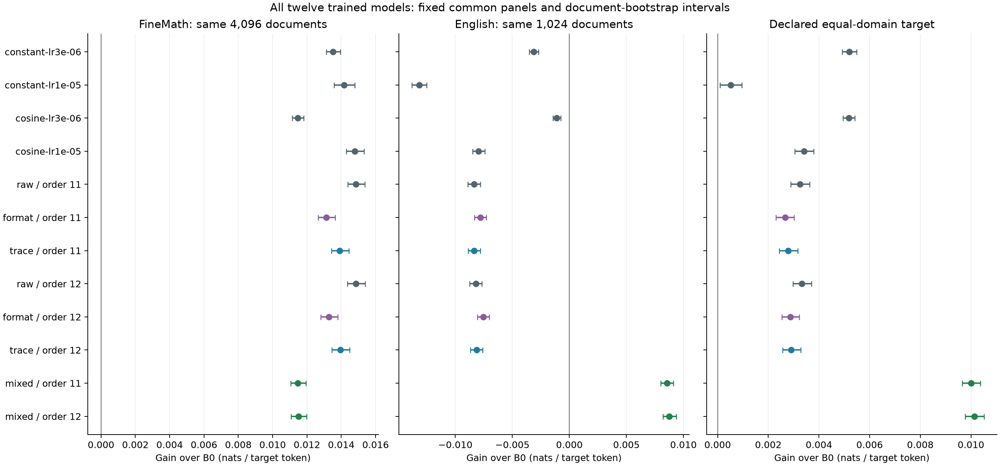

# Overnight results — October 22, 2026

Updated 11:15 UTC. The main program is complete before the owner's 12:00 UTC / 08:00 Eastern deadline. Final usage accounting and one bounded TRAIN-only derivative diagnosis remain in progress.

**Ordinary continued pretraining now has a healthy reference. Mixing ordinary mathematical and educational-English sources improves prediction in both tested domains. Adding verified computation supervision does not improve direct learning against the matched ordinary-training control.**

Twelve fixed 1.7B models finish 128 updates each. Each receives 17.3–18.3 million original target positions; **213.7 million across the twelve fits**, drawing from **51,200 unique training documents** shared across arms. The count across fits is not a claim of that many distinct source tokens or a long pretraining trajectory.

| Question | Completed result | Evidence |
|---|---|---|
| Can ordinary uniform next-token training beat B0? | Yes: +0.014481 [0.013903, 0.015058] nats/token on 4,096 fresh FineMath windows. DEV chooses among all four completed fixed settings before confirmation. | [Baseline report](../validation/uniform_lm_baseline_complete_20261022/REPORT.md) |
| Does post-document computation supervision improve direct learning? | No under this recipe: −0.000944 / −0.000908 nats/token against same-data ordinary training, negative intervals in both orders. Trace beats format-only supervision but loses to the qualified ordinary reference. | [All six models and 26 comparisons](../validation/scaffold_learning_complete_20261022/REPORT.md) |
| Does mathematical-only training preserve English prediction? | All ten mathematical-only models lose to B0 on the separate 1,024-document educational-English panel. The selected ordinary reference loses 0.008835 nats/token. | [Full retention diagnostic](../validation/general_web_retention_complete_20261022/REPORT.md) |
| Can ordinary source mixing address that cost? | Yes: both orders improve fresh Math by +0.011346 / +0.011204 and fresh English by +0.008550 / +0.008756 nats/token, all positive intervals. The 50/50 target beats the qualified all-math reference by +0.006578 / +0.006610. | [Two-order confirmation](../validation/uniform_mixture_complete_20261022/REPORT.md) |
| Do the findings survive standard CPU forwards? | On 1,024 fixed documents, CPU trace-minus-raw gains remain negative in both orders: −0.000928 / −0.000890, with negative intervals. The separate two-domain mixture CPU check also passes its fixed numerical thresholds. | [8,192-forward check](../validation/scaffold_standard_CPU_verification_20261022/REPORT.md), [mixture check](../validation/uniform_mixture_CPU_forward_check_20261022.json) |

## The useful tradeoff

The all-mathematical reference remains stronger on mathematics alone. Source mixing sacrifices approximately 0.0034 nats/token of that gain while reversing the English regression. Each mixed-source system uses **one model** at inference; the mixture describes its training documents and the declared evaluation target.

On common windows for every fixed model, both mixed models improve on B0 in both domains. All ten mathematical-only models lose on English. The two mixed models have the largest descriptive gains on the declared equal-domain target; this comparison does not select a new checkpoint or replace any parent's confirmation criterion.

[All common-panel scores, conditional document intervals and controls](../validation/overnight_common_panel_complete_20261022/REPORT.md).

## What this means for the research question

The new negative auxiliary result has a competent direct control. Source coefficients and context are matched, every arm learns relative to B0, and the auxiliary loses to ordinary training in two source orders. This is stronger evidence against this particular supervised recipe than a failure shared with a regressing control.

It does not show that intermediate computation is useless. Earlier generated-calculation gains and targeted selective-inference gains remain real within their declared scope. The previous frozen selector still loses on its unenriched natural endpoint. That inference interface and the new ordinary-training models test different mechanisms.

The post-document writer sees all 528 original tokens before predicting work. Its verified labels are prefix-derived, but this does not make the writer prospective. Autonomous thought discovery, onset across pretraining ages and efficient internalization remain unresolved. The saved TRAIN-only fixed-reader diagnostic offers only **+0.0266 nats/span** of hindsight best-of-eight gain over greedy; no writer update follows from it. [That bounded diagnostic](../validation/writer_feedback_opportunity_20261022/REPORT.md).

These are short continued-training studies from one mature starting model, on bounded FineMath and educational-English frames. Source freshness is relative to this project, not proven absence from base pretraining. Full-window likelihood includes short contexts; final 16-token spans are reported separately. For example, the mixed order 11 English suffix interval spans zero even though its full-window gain is positive. These results do not establish free-running answer accuracy, a general-language gain or an autonomous reasoning capability.

## Models and numerical evidence are ready

Every one of the **twelve public model assets** was anonymously downloaded, hash-checked and reconstructed with the downloaded standalone tools. All original BF16 tensor values match exactly. Every restored model loads through standard Hugging Face and returns finite logits. A separate new CPU-only environment also restores the selected ordinary model and runs HF inference with **no Neuron or XLA installed**. This verifies artifact usability, not additional model quality.

[Model catalog and direct downloads](MODELS_20261022.md) · [Restore instructions](RECONSTRUCT_MODELS.md) · [Exact reconstruction receipt](../validation/trained_models_public_release_20261022.json) · [All HF checks](../validation/trained_models_HF_smoke_20261022.json) · [Clean CPU proof](../validation/trained_model_clean_CPU_environment_20261022.json).

All six numerical archives and the mixture CPU supplement pass anonymous download, member hashes and standalone NumPy replay. They preserve the original per-token scores and every outcome, including failed criteria. This is within-repository numerical verification, not an external training replication. Raw source text and source token IDs are omitted from numerical archives. Native optimizer snapshots remain retained separately; public model downloads contain weights and tokenizer.

## Costs and machine use

| Completed native study | Actual assigned chip-hours | Separate ceiling |
|---|---:|---:|
| Ordinary baseline, including earlier qualification failures | 16.607276 | 18 |
| Matched raw/format/computation study | 32.536880 | 40 |
| Separate English retention diagnostic | 0.502299 | 1.5 |
| Two-order source-mixture study | 6.290836 | 7.5 |
| Common-panel supplement | 0.962545 | 1.25 |
| **Total** | **56.899836** | **68.25** |

These per-study totals include earlier qualification and all eight nonzero-exit native attempts. They are not the whole-node invoice or a claim that every reservation began after 22:00 Eastern. All 85 native attempts have closure records; historical incomplete process-absence flags remain unchanged. Current inventory shows no processes on any of the sixteen accelerator devices. [Exact closure/counter reconciliation](../validation/overnight_resource_summary_20261022.json).

The node was **not fully saturated**: peak observed use was eight of sixteen chips. Concurrency preserved host-memory and complete-state export headroom. Read-only usage accounting reports observation coverage and leaves missing intervals unknown; assigned reservations, process occupancy, core busy time and FLOP efficiency are different measurements. The 35 GiB free-storage and 512 GiB available-host-memory floors remain unchanged.

All **2,074 CPU tests**, smoke and compilation pass. Original sources, complete native checkpoints and historical results remain retained. The existing Trainium environment was not modified by the isolated CPU portability test.
