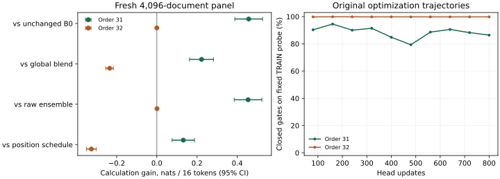

# Frozen causal reader: useful selection in one order, failed two-order criterion

**Complete, independently reconstructed; overall predeclared criterion fails.**
One frozen selector learns to improve full 16-token continuation prediction on
fresh calculation documents while largely declining the assisted predictor on
ordinary text. The second head-training order mostly closes its gate and does
not reproduce the benefit. Both terminal outcomes are retained.

This is a bounded inference experiment over two frozen Qwen3-1.7B predictors.
It does not improve either backbone's weights, establish internalized reasoning,
or reopen V29/V30's closed predictive-reward branch. No follow-on run is queued.

## What ran

- Identity: `causal-reader-owner-approved-20261021-v1`; frozen engine `3482f59`.
- Actual unchanged Qwen3-1.7B-Base B0 and the first V29 computation checkpoint T;
  prefix-only greedy notes from frozen T. No teacher supplies deployed notes.
- One probability mixture per predicted token, `(1-g) p_B0 + g p_T_note`.
  The 4,102-parameter head sees pre-target hidden states, entropy, note stopping/
  length metadata and position. Current/future targets and their probabilities
  are excluded from its inputs. Only head parameters receive gradients.
- Source-separated TRAIN: 2,560 calculation and 2,560 ordinary documents.
  Fresh DEV: 4,096 calculation and 4,096 ordinary FineMath documents. Original
  source/expression exclusions and all source counts were preserved.
- Four heads: note-assisted and unassisted T ensembles, each with orders
  2026102131 and 2026102132, ten TRAIN passes and exactly 800 updates per head.
  All four terminals froze at **14:37:18 UTC**, before first DEV launch at
  **14:37:20 UTC**. There was no held-out checkpoint selection or refitting.
- Global and 16-position mixture controls were fitted on TRAIN only. Fixed
  256-source empty/donor/oracle/corrupt interventions held original generated
  note length/stopping metadata constant. Their results remain secondary.

These are **two optimization orders for a small head over the same frozen
backbone pair**, not two independent replications of backbone training.
Likelihood teacher-forces preceding continuation tokens; it is not free-running
answer accuracy. Official TEST was not used.

## Primary result

Positive differences mean better full-span log probability. Intervals are
paired 5,000-draw percentile bootstraps over 4,096 unique source documents,
conditional on these fixed checkpoints and heads.

| Calculation-panel contrast, nats per original 16 tokens | Order 2026102131 [95% CI] | Order 2026102132 [95% CI] |
|---|---:|---:|
| Selector − unchanged B0 | **+0.4572 [0.3879, 0.5262]** | −0.00002 [−0.00052, 0.00042] |
| Selector − TRAIN-fitted constant blend | **+0.2225 [0.1629, 0.2820]** | −0.2348 [−0.2538, −0.2162] |
| Selector − learned B0/T-without-notes ensemble | **+0.4542 [0.3850, 0.5226]** | +0.00089 [−0.00144, 0.00335] |
| Selector − TRAIN-fitted position schedule, secondary | **+0.1315 [0.0759, 0.1876]** | −0.3257 [−0.3499, −0.3010] |

The original base requirement is a gain of at least 0.25 nats per span and a
positive lower bound. The constant-blend and raw-ensemble requirements each
need a positive lower bound. Ordinary NLL cost must have upper bound no greater
than 0.03 nats/token. **All four must pass in each order.**

| Predeclared requirement | Order 31 | Order 32 |
|---|---|---|
| Calculation benefit versus B0 | PASS | FAIL |
| Benefit versus global mixture | PASS | FAIL |
| Benefit versus unassisted ensemble | PASS | FAIL |
| Active ordinary-text tolerance | PASS | PASS |
| All eight jointly | **FAIL overall** | **FAIL overall** |

Order 31's result is a real prospective selective-inference gain under the
declared comparisons, rather than the earlier hindsight token oracle. Beating
the position schedule also rules out that particular fixed-position explanation.
It does not make order 32 disappear or establish reliable optimization.

All absolute arms are in [absolute-likelihood.csv](absolute-likelihood.csv).
For context, the always-assisted predictor loses 1.0191 nats/span versus B0 on
the calculation panel; the TRAIN-fitted global blend gains 0.2348 and the position
schedule gains 0.3257. The unassisted T global blend gains 0.0670 descriptively.
The raw-ensemble learned heads mostly close too, so they do not exhaust stronger
possible ensemble procedures. No new primary contrast was selected from these
absolute scores.

## Retention and corpus-wide interpretation

| Active ordinary FineMath NLL cost versus B0, nats/token | Mean [95% CI] |
|---|---:|
| Order 31 | +0.002014 [0.001338, 0.002747] |
| Order 32 | +0.000234 [0.000102, 0.000394] |

Both meet the declared tolerance; **both still worsen ordinary prediction**.
Exact fallback when the gate is zero is a separate identity, not a universal
no-regression guarantee for an active selector.

The original [prevalence table](readout.json) keeps hypothetical calculation
prevalence separate from observed results. Order 31's point estimates break
even at about **6.58%** calculation spans under this two-stratum mixture. At
hypothetical prevalence 10%, its mean gain is 0.01672 nats/span with interval
[0.00415, 0.02862]; at 5%, the interval crosses zero. Natural prevalence was
**not measured**, and the two panels do not establish a general-corpus gain.
These are mathematical web-text measurements, not broad language evaluation.

## What the diagnostics identify

Order 31 closes its gate on 70.46% of calculation tokens and 98.54% of ordinary
tokens. Order 32 closes on **99.87%** and **99.47%**, respectively. On the fixed
TRAIN probe the second order was already 99.80% closed; this was recorded before
the final readout. Its terminal pre-clipping data-gradient norm is about
1.33e-5, versus 0.0791 in order 31's final batch. These are different batches,
not a controlled gradient comparison.

The specified exact-zero region has zero local derivative. The observed closure
and small gradients support optimization stalling as a concern; they do not
isolate it as the cause or prove that another head cannot learn. No gate,
learning rate, threshold, checkpoint or training exposure was changed afterward.
The full [fixed TRAIN probe history](fixed-TRAIN-probes.json) and terminal
[update diagnostics](terminal-TRAIN-updates.json) remain available.

On the fixed secondary panel, order 31's own notes beat empty notes by
0.6016 [0.2813, 0.9195], unrelated notes by 1.6403 [1.2000, 2.0744], and corrupted
notes by 1.3744 [0.9998, 1.7424] nats/span. Correct supplied work is better than
own work by 0.5474 [0.2922, 0.8350]. Order 32's differences are effectively zero.
These interventions support a content contribution in the first order; oracle
work is privileged and none establishes faithful internal reasoning. The
independent primary checker does not reconstruct secondary interventions.

## Execution, approved exceptions and verification

All **100 native workers and one CPU fitting worker** closed successfully across
13 native phases. All **13,312 note attempts**, **632,360 generated actions** and
**40,960 reader contexts** remain in the record. TRAIN has 622 capped notes;
ordinary DEV has 990; calculation DEV has none. Caps and other stopping outcomes
were retained without filtering. Every generation status is `ok`.

Actual reserved accelerator spend is **3.89200372 chip-hours**, including
**0.11895162** across both earlier qualification attempts, versus the explicitly
approved **8.25** ceiling. Maximal concurrent allocation was two existing chips.
The science supervisor closed at 15:48:07 UTC; the final topology records zero
native processes. No writer RL, backbone update, model-size change, cloud purchase,
paid teacher or accelerator-stack change occurred. Original states and evidence
remain preserved. Reserved chip-hours are not a cloud invoice or serving benchmark.

The owner approved the five already-recorded numerical deviations and the small
timing-projection exception **before fitting or scientific DEV outcomes**.
The original strict qualification remains failed; it has not been relabeled PASS.
See the [approval](../causal_reader_owner_approval_20261021.json),
[original failed qualification](../causal_reader_qualification_complete_20261021.json)
and [accepted evidence](../causal_reader_owner_release_20261021/accepted-qualification.json).
All remaining identity, causality, normalization and exact-fallback checks passed.

The [independent checker](independent-readout.json) reconstructs causal-head
arithmetic from original native hidden features using separate NumPy code. It
matches target probabilities, gates, every absolute arm, paired bootstrap
statistics and all eight decisions. This is within-repository reconstruction,
not external replication or a fresh backbone rerun. The 1,970 prelaunch CPU tests
and qualification mechanics are engineering evidence, not scientific success.

The [source-free release](https://github.com/dario-fumarola/useful-thoughts-trainium/releases/tag/causal-reader-owner-approved-20261021)
includes native target probabilities, mixed probabilities,
gates, document scores, source identity hashes and TRAIN logs. Its standalone
replay checks mixture arithmetic and paired statistics, including secondary
statistics. It omits source windows, actual target tokens, model weights and
hidden features; it cannot reproduce model execution or establish feature causality.

**Decision:** preserve a positive single-order mechanism result and a failed
reproducibility requirement. Close this bounded experiment without scaling,
retraining a convenient order, writer RL, or another automatic campaign. V29 and
V30 remain unchanged. A future proposal should address reproducible selector
optimization without presenting this as recovered pretraining or internalization.
