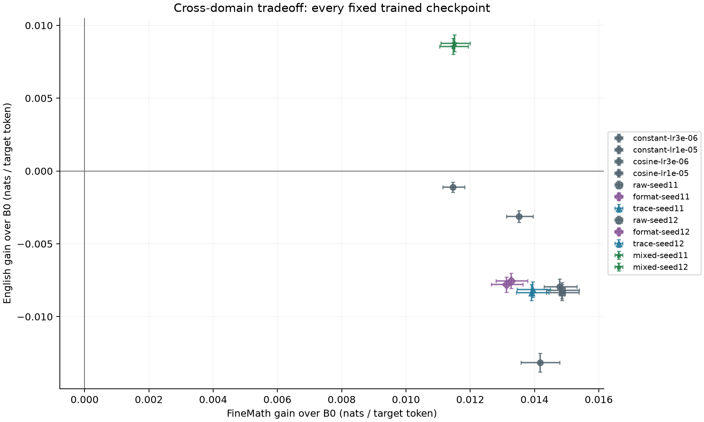

# All fixed overnight models on common text panels

**Both mixed-source models improve on B0 in both domains; all ten mathematical-only models regress on English.** Their mathematical gains are retained, and the all-math reference remains stronger on mathematics alone. This is the direct cross-domain tradeoff on common windows.

Thirteen fixed predictors, including B0 and all twelve trained models, share the same mathematical and English windows. This supplemental comparison adds no fitting, selects no model and changes none of the original scientific decisions. The separate baseline, matched-supervision and source-mixture confirmation reports remain authoritative for their declared tests.

## Every model and both domains

All gains below are **nats per original target token**, using all 527 predicted positions. Positive means better prediction. Intervals resample source documents conditional on the fixed checkpoint. The 50/50 column is an explicitly declared diagnostic target, not natural language prevalence.

| Model | Mathematics gain over B0 | English gain over B0 | Declared 50/50 gain over B0 |
|---|---:|---:|---:|
| warmup_constant-lr3e-06 | +0.013522 [+0.013134, +0.013954] | -0.003125 [-0.003523, -0.002715] | +0.005198 [+0.004920, +0.005488] |
| warmup_constant-lr1e-05 | +0.014169 [+0.013584, +0.014786] | -0.013145 [-0.013796, -0.012512] | +0.000512 [+0.000087, +0.000952] |
| warmup_cosine-lr3e-06 | +0.011462 [+0.011143, +0.011821] | -0.001113 [-0.001451, -0.000771] | +0.005175 [+0.004942, +0.005417] |
| warmup_cosine-lr1e-05 | +0.014790 [+0.014294, +0.015322] | -0.007959 [-0.008495, -0.007412] | +0.003415 [+0.003049, +0.003789] |
| scaffold_raw-seed11 | +0.014852 [+0.014372, +0.015382] | -0.008350 [-0.008896, -0.007803] | +0.003251 [+0.002892, +0.003637] |
| scaffold_format-seed11 | +0.013123 [+0.012651, +0.013638] | -0.007803 [-0.008333, -0.007276] | +0.002660 [+0.002304, +0.003022] |
| scaffold_trace-seed11 | +0.013908 [+0.013438, +0.014442] | -0.008345 [-0.008890, -0.007804] | +0.002781 [+0.002426, +0.003157] |
| scaffold_raw-seed12 | +0.014855 [+0.014368, +0.015395] | -0.008204 [-0.008751, -0.007666] | +0.003325 [+0.002973, +0.003706] |
| scaffold_format-seed12 | +0.013277 [+0.012799, +0.013787] | -0.007538 [-0.008052, -0.007022] | +0.002870 [+0.002527, +0.003224] |
| scaffold_trace-seed12 | +0.013947 [+0.013462, +0.014491] | -0.008134 [-0.008672, -0.007596] | +0.002907 [+0.002558, +0.003277] |
| mixed-seed11 | +0.011470 [+0.011047, +0.011932] | +0.008550 [+0.008015, +0.009106] | +0.010010 [+0.009661, +0.010368] |
| mixed-seed12 | +0.011515 [+0.011078, +0.011993] | +0.008756 [+0.008191, +0.009363] | +0.010135 [+0.009778, +0.010516] |

B0 absolute NLL is 1.451454 on mathematics and 2.489419 on English. Final 16-token span results are separate in [all comparisons](all-paired-contrasts.csv).

## Why this comparison is supplemental

The mathematical panel is the matched-scaffold study's 4,096 source-separated confirmation windows. The English panel is the mixture study's 1,024 source-separated confirmation windows. Their source definitions were already fixed; this common comparison was declared before scaffold confirmation outcomes. Existing scores are reused exactly: eight mathematical predictors from the scaffold study and four English predictors from the mixture study. The selected ordinary model is renamed from the cached uniform_reference alias only after checking its exact checkpoint SHA. Fourteen further inference jobs fill the missing cells. No source row is replaced or selected by its score.

Every terminal model and both parent primary readouts must close before the new common jobs start, independent of their scientific verdicts. The ordinary baseline's DEV choice and original confirmation decision are unchanged. The source-mixture study has its own distinct fresh mathematical panel; this diagnostic cannot rescue or replace its criterion. A favorable result in this table does not retroactively select a new confirmed winner.

The trained recipes have different source composition: ordinary baseline models see 32,768 mathematical windows; matched scaffold models see those plus 2,048 calculation windows; mixed models see 16,384 mathematical and 16,384 English windows. Only comparisons within the matched scaffold arms isolate their auxiliary objective under matched exposure and shape. Cross-family comparisons describe practical predictive tradeoffs, rather than a pure causal effect of thought supervision. All start from the same released base; the two source orders are not independent pretraining histories.

## Numerical execution and cost

The original mathematical and English workers are reused from their frozen source trees, with an identical hash-bound likelihood kernel. Original FP32 target scores are preserved exactly. Model SHA, full terminal count, original source receipts, target geometry and named job protocol checks remain active. There is no generated calculation at evaluation, new model fitting, new source acquisition or official TEST access.

The measured go/no-go check precedes execution. Actual additional assigned reservations total **0.962545 chip-hours**, including every attempt, below the fixed 1.25 ceiling. At most three existing two-chip groups are used; native stop is 11:10 UTC. The 35 GiB filesystem and 512 GiB available-host floors are unchanged. These are additional inference costs, excluding the already-reported parent training and cached-score costs; they are not a whole-node invoice.

All 527 tokens travel together when resampling unique source documents: 5,000 percentile draws, seed 17 for mathematics and 19 for English. The declared equal-domain interval combines independent draws from those two strata. Individual intervals are not simultaneous coverage over all models and do not measure all training or development uncertainty. These bounded FineMath and educational-English frames are neither all language nor sources proven absent from original base pretraining.

A standalone NumPy reconstruction reproduces every absolute score and all 36 domain/target contrasts from the released original scores. This is within-repository numerical verification, not external model replication or verification of source text omitted from the source-free archive. See [complete readout](readout.json), [frozen plan](prospective-design.json) and [numerical reconstruction](independent-numerical-replay.json).
