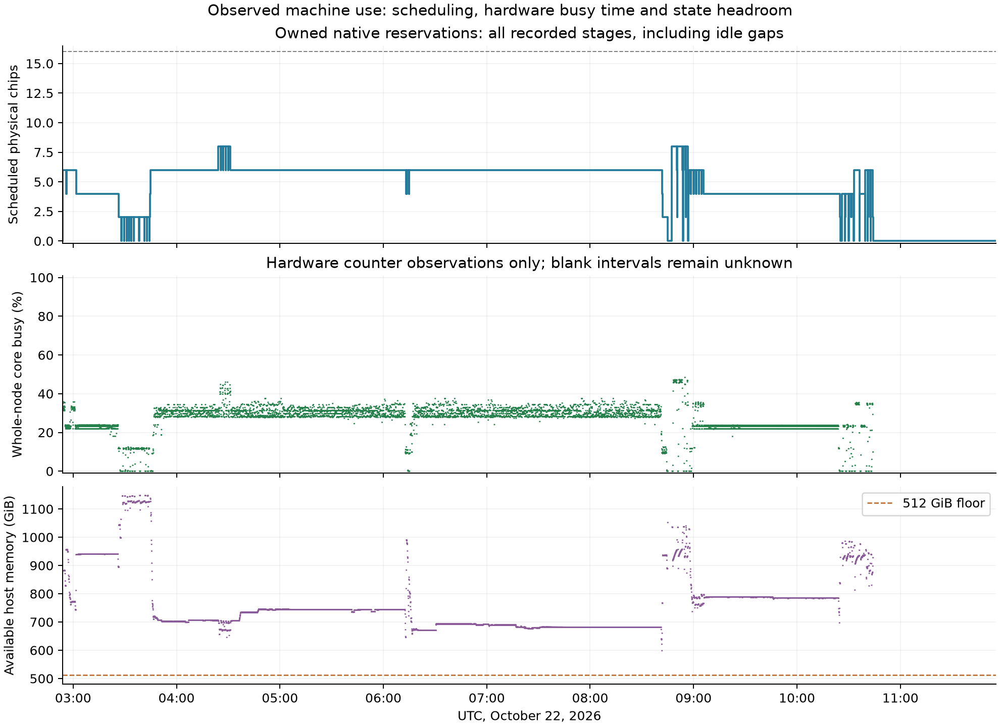

# Machine use during the observed overnight window

The whole machine was **not saturated**. Observed process occupancy peaks at **8 of 16 chips**. Across covered hardware-counter periods, whole-node core busy time averages **26.96%**, and process occupancy averages **5.38 chips**. These conditional averages must not be presented as whole-window utilization.

The explicit window is **2026-10-22T02:53:54.745063+00:00 to 2026-10-22T11:55:36.757630+00:00**. Valid counters cover **84.90%** of that interval; **81.80 minutes** remain unobserved. The monitor emits only valid NRT reporting periods. Missing periods are not replaced by zero, and process inventory can lag launches/exits by one minute. A sample is carried for at most ten seconds.

The owned-stage ledgers schedule **41.740398 chip-hours** inside the same window, versus **144.453389 physical-chip-hours of node capacity**: **28.90%** of available chip time scheduled to this program. This includes compilation, startup and export while an owned stage holds its group; it differs from core busy time and FLOP efficiency. It also differs from the per-study **56.899836 assigned chip-hours**, which include qualification before this observation window. Every positive-cost stage has recorded clock fields; the one prelaunch record without clocks costs zero.

Minimum observed available host memory is **598.40 GiB**, above the unchanged 512 GiB floor. Retained states and checkpoint-export headroom constrained simultaneous full trainers. All native work is now closed; CPU verification, artifact publication and the bounded derivative diagnosis account for later host work. No new capacity or accelerator-stack change was made.

[Complete summary](summary.json) · [Original compressed telemetry](telemetry.jsonl.gz) · [Per-study closure reconciliation](../overnight_resource_summary_20261022.json). The analysis is implemented in `scripts/summarize_node_utilization.py`; this summary records its raw-input hash. These measurements are not a whole-node monetary invoice or a claim of FLOP efficiency.
