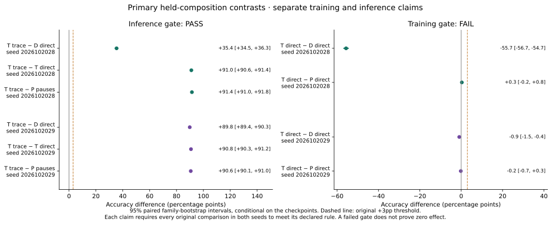
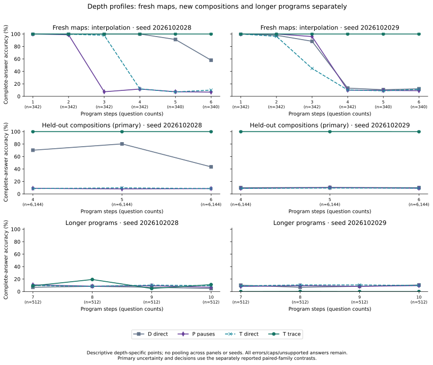
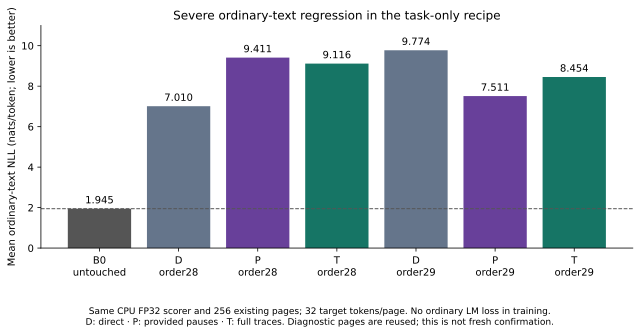

# V28: useful generated computation, with a sharp boundary

The declared **inference gate passes** in both data orders. The separate **training gate fails**. Verified full-trace supervision teaches almost perfect execution of fresh permutation compositions at trained lengths; it does not produce a stronger direct answerer, reliable longer execution, or a better ordinary language model.

Six fresh Qwen3-1.7B-Base models see the same 32,768 questions over four passes and 4,096 updates: direct training (D), full-trace training (T), and trained provided pauses (P), each under data orders 2026102028/2026102029. Training lengths are 1–6. The primary panel contains new maps and held operation compositions at lengths 4–6, with 18,432 questions in 9,216 counterfactual families. Terminal checkpoints were frozen before evaluation.

| Primary answer path | Order 28, correct /18,432 | Order 29, correct /18,432 |
|---|---:|---:|
| D direct | 11,914 | 1,872 |
| D empty format | 11,812 | 1,871 |
| P provided pauses | 1,576 | 1,733 |
| T direct | 1,654 | 1,701 |
| T empty format | 1,636 | 1,728 |
| **T generated trace** | **18,432** | **18,430** |

T trace minus D direct is **+35.4pp [34.5,36.3]** and **+89.8pp [89.4,90.3]**. All three original inference comparisons pass in each order. The first direct control is substantially stronger than the second; do not report only the larger gain. These are paired family-bootstrap intervals conditional on these checkpoints, not broad uncertainty over training runs.

T direct minus D direct is **−55.7pp [−56.7,−54.7]** and **−0.9pp [−1.5,−0.4]**. Generating the computation helps; removing it does not preserve the benefit. Interpolation traces score 2,048/2,048 in both orders. Almost every correct primary trace also executes every transition correctly, rather than merely arriving at the answer by chance.

## Longer programs expose the stopping boundary

At unseen lengths 7–10, generated traces score **228/2,048** and **1/2,048**. None hits the generation cap. The second model emits exactly six transitions on all 2,048 questions; 2,030 are correct six-step execution prefixes. Both models copy their last generated state into the final answer on every longer question. The first model sometimes goes beyond six, but is unreliable. This is a length/generalization failure, not evidence of an insufficient token cap.

Supplied partial states give **0/1,024** correct answers in each T model. The final answer usually copies the last supplied state, which deliberately precedes the root operation. This partial-completion interface was not trained. Its failure documents a boundary; it is not a substitute for the successful full self-generated execution result.

## Ordinary prediction and cost

The task-only recipe has no ordinary LM loss. Ordinary-text NLL is **9.116/8.454** for T, versus **1.945** for unchanged B0. All six task-trained models regress severely (7.010–9.774). All stored token scores, page means, and bootstrap intervals were independently reconstructed; 28 ordinary Hugging Face forwards on four fixed pages per model agree within 0.000027 nats/token. These existing pages are a retention diagnostic, not a fresh confirmation set.

Each T model receives 2,031,520 nonzero supervised positions, versus 655,360 for D/P: **3.10×**, with separately normalized final-answer and trace losses. Source exposure and updates are matched; label information is not. At primary inference, T generates **35 actions/question**, versus **2** for direct answers. P receives 30 pause positions per question during parallel prefill. That does not match autoregressive computation or establish an efficiency advantage.

## Evidence and decision

All 23 original jobs physically close, covering **378,880 attempts** and 92 native/cache checks each. Independent token/parser/interpreter/bootstrap reconstruction passes. All failures stay in their original denominators: 2,023 capped B0 attempts and 29 unsupported partial-control answers. No execution errors occur. Actual science training uses 16.535 reserved chip-hours; evaluation uses 13.821. Separate qualifications are reported separately.

The [raw release](https://github.com/dario-fumarola/useful-thoughts-trainium/releases/tag/v28-controlled-computation-20261020) preserves every synthetic input, gold, original attempt and native witness. Its extracted portable index reproduces the original primary readout bytes without a model or accelerator. The [original fixed examples](fixed-examples.json) remain unchanged; [post-hoc diagnosis](stored-trace-diagnosis.json) additionally includes hash-selected longer examples. Original model/optimizer states remain on same-instance EBS.

Keep this as a successful **guided computation reference within covered lengths**, with failed direct transfer and longer execution. Do not scale RL or claim autonomous thinking from it. The next mainline step is actual source-balanced prefix-to-continuation training on real text, with explicit ordinary LM supervision and strong source/format controls. Data, endpoint, and actual training-shape qualification come before another long run. V26's earlier document-QA training-side signal remains developmental and unconfirmed.
