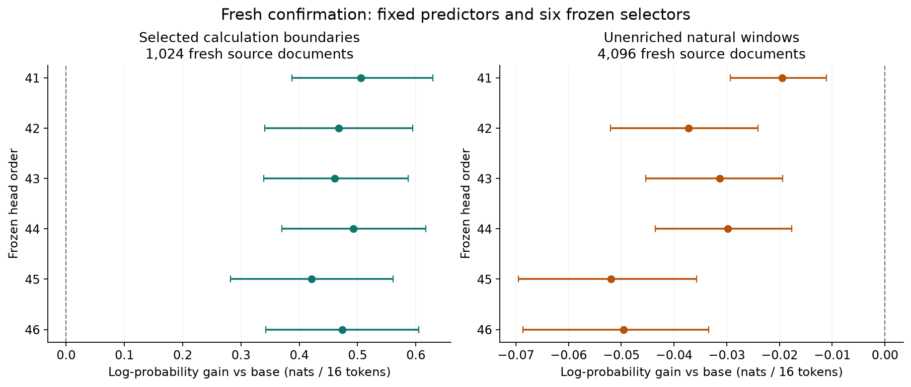

# Fresh fixed-selector confirmation: targeted gains, natural-text losses

**Every frozen selector improves the 1,024 fresh calculation continuations over the unchanged base, by 0.421–0.506 nats per original 16-token span. Five of six also beat every additional control. All six worsen prediction on the 4,096 unenriched natural windows.** The two prospectively separate confirmation endpoints therefore fail: one calculation-control interval crosses zero, and the natural endpoint is negative in every order.

This is stronger fresh evidence for a limited calculation-assisted inference benefit. It does not establish a better predictor on the declared natural distribution or improved pretrained weights.

## All fixed orders

Higher is better; entries are nats per complete original 16-token continuation with paired 95% intervals. “All controls” requires a positive lower bound against each of the five additional controls, not merely a better point estimate.

| Frozen order | Calculation gain vs B0 | Natural gain vs B0 | Beats all five other calculation controls | Beats all five other natural controls |
|---|---:|---:|---|---|
| 2026102141 | +0.5058 [+0.3876, +0.6291] | -0.0195 [-0.0293, -0.0111] | True | False |
| 2026102142 | +0.4681 [+0.3412, +0.5944] | -0.0372 [-0.0520, -0.0241] | True | False |
| 2026102143 | +0.4605 [+0.3389, +0.5872] | -0.0314 [-0.0454, -0.0194] | True | False |
| 2026102144 | +0.4924 [+0.3702, +0.6169] | -0.0298 [-0.0436, -0.0177] | True | False |
| 2026102145 | +0.4209 [+0.2822, +0.5609] | -0.0519 [-0.0696, -0.0358] | False | False |
| 2026102146 | +0.4738 [+0.3425, +0.6049] | -0.0495 [-0.0686, -0.0334] | True | False |

Order **2026102145** gains **+0.0752 nats [−0.0418, +0.1876]** over the calculation-based position schedule. Its base-model comparison passes, but this additional-control comparison does not. The original all-six calculation requirement remains failed; there is no replacement order or retrospective gate change.

On natural windows, every base-model interval is entirely negative. Per-token NLL costs range from **+0.00122 to +0.00325**. All satisfy the older +0.03 retention tolerance, while none establishes the separately required natural improvement. Tolerating a loss is different from gaining prediction quality.

The panels use different horizontal scales. The figure shows base-model comparisons; the [complete contrasts](paired-contrasts.csv) include every control and the [order table](all-orders.csv) retains every decision.

## Strong simple controls

`T_note` is the frozen specialized predictor conditioned on its own greedy calculation. `T_raw` is the **same specialized checkpoint without a calculation**, not V29's separately trained raw arm. Global and position weights were fitted only on the old fitting split and stayed fixed.

| Fitted simple control vs B0 | Calculation gain | Natural gain |
|---|---:|---:|
| T_note global | +0.2476 [+0.2082, +0.2909] | -0.1253 [-0.1365, -0.1132] |
| T_note position | +0.3457 [+0.2949, +0.4014] | -0.1460 [-0.1595, -0.1312] |
| T_raw global | +0.0657 [+0.0427, +0.0909] | +0.0244 [+0.0155, +0.0340] |
| T_raw position | +0.0697 [+0.0456, +0.0965] | +0.0199 [+0.0103, +0.0296] |

The no-calculation global mixture improves natural prediction by **+0.0244 nats [0.0155, 0.0340]**, whereas every calculation-selector head loses to B0. This is evidence against presenting the current calculation selector as the best natural-text system. It also shows why a mostly inactive learned ensemble is not the only relevant control.

All six calculation heads beat the no-calculation global/position mixtures and matched learned heads on the targeted calculation panel. Five also establish an advantage over the stronger calculation position schedule. The calculation-conditioned predictor alone is worse than B0 on that panel; selective use recovers predictive value. Neither comparison establishes that the selector verifies a calculation's semantic correctness.

## What was fixed before outcomes

The unchanged B0 and first V29 computation checkpoint, all six original hard-gate terminal-640 heads, six matching no-calculation heads, and fitted controls were frozen before any fresh predictor outcome. There was **no new head or backbone fit** and no order, checkpoint, prompt or row selection from these results. [Prospective design](../../configs/reader_fresh_confirmation_design.json).

The 1,024 targeted examples are source/expression-disjoint verified calculations. The 4,096 natural documents and cuts were chosen by source identity and length, without calculation labels or serialization-outcome filtering. Every selected window independently matches pinned Parquet data; none was replaced. This natural estimand is uniform eligible documents with a bounded hash-selected position, not token-weighted all-FineMath traffic. The source frame was already cleaned and depleted by earlier studies. [Source proof and population census](../reader_population_census_20261021/REPORT.md).

The outcome is teacher-forced likelihood of all 16 original native continuation tokens. Preceding continuation tokens are supplied correctly; this is not free-running answer accuracy. Bootstrap draws resample the **unique source document**, carrying its complete span and every paired arm together: 5,000 percentile draws, fixed seeds 2026102151/2026102152, unadjusted intervals. Six heads share one frozen model pair and sources; their intervals do not estimate independent backbone-training uncertainty. Freshness is relative to this project's sources, not proven novelty relative to base pretraining.

## Resources and numerical verification

| Panel | Generated notes | Generated actions | Capped notes |
|---|---:|---:|---:|
| CONFIRM_calculation | 1,024 | 37,378 | 0 |
| CONFIRM_natural | 4,096 | 241,307 | 990 |

All **5,120 notes and 15,360 predictor contexts** completed; capped notes remain included. Sixty-four scientific native workers closed successfully. Actual cost was **1.781765 reserved chip-hours including 0.130007 for qualification**, below 4.25, using at most two existing physical chips. Scientific native execution took 49.6 minutes. The cost includes controls and reservations, so it is not a controlled serving-efficiency benchmark. Declining a note after generating it does not recover its cost.

Compiler flags explicitly specify `--model-type=transformer --auto-cast=none`. The new prospective numerical contract passed; the earlier stricter failure stays unchanged. Qualification-only native/CPU head sensitivity was at most 0.00010249 nats per span across the fixed heads, not a uniform bound on new sources. [Complete qualification records](../reader_fresh_confirmation_qualification_20261021/).

Independent NumPy reconstruction reproduces features, gates, mixtures, absolute scores, all **80 paired contrasts**, and both failed endpoint decisions from the original caches. It shares the original cache loader and is not external replication. [Reconstruction receipt](independent-readout.json). All **2,004 CPU tests**, smoke and compilation pass.

The source-free public replay also verifies all three predictors' token scores, stable logit-based mixture arithmetic, document totals, routing, bootstrap intervals and decisions. Original logits are exported because a rounded gate near one can lose a small base contribution. Original scientific scores and numerical thresholds were unchanged. [Replay receipt](public-projection-replay.json), [replay script](../../scripts/replay_reader_confirmation.py).

## Interpretation

A repeated targeted computation benefit and a negative natural-text result coexist. The census is not used to reweight the enriched calculation score into a claimed natural gain; the fresh natural windows measure that question directly. The unassisted simple ensemble's positive result remains visible.

The immediate claim is selective inference over this frozen pair on calculation boundaries. Better backbone weights, internalization and autonomous discovery remain separate questions. Before returning to continued-pretraining claims, the next baseline must be genuine uniform next-token training, with no duplicated or upweighted continuation branch. These completed sources and scores are now development evidence for any redesign.

[Full readout](readout.json) · [Public numerical evidence](https://github.com/dario-fumarola/useful-thoughts-trainium/releases/tag/reader-fresh-confirmation-20261021)
