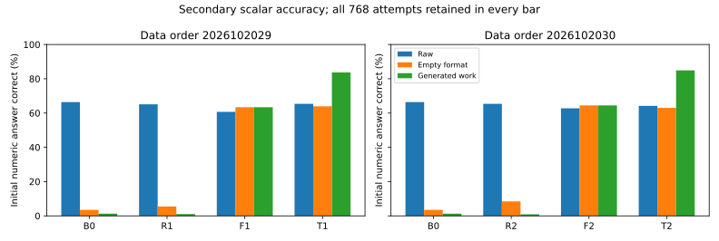
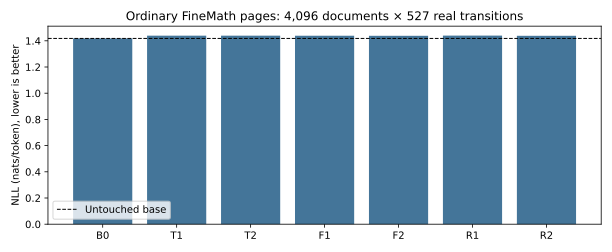

# V29: real continuation training with verified computation

**The primary CPT criterion fails. Generated work substantially improves the
initial numerical completion, but does not establish better direct continuation
prediction. The full-window retention target passes with a small, measurable
ordinary-text regression.** These are separate results.

Six fresh Qwen3-1.7B-Base models complete 1,280 updates each: raw, empty-format,
and computation training under two data orders. Every arm receives the same
clean-text LM objective on 20,480 real FineMath windows over two passes.
The calculation subset is deliberately enriched to 25% of training documents.
Computation labels come from an exact interpreter of the available prefix.
The terminal checkpoints, cohorts, prompts, parsers, and gates were fixed before
held model execution. Official TEST was not accessed.

## Primary result: direct full-span prediction

Higher log likelihood is better. Each row is a paired contrast on 768 fresh
calculation documents, scoring all 16 original source-continuation tokens.
Intervals resample documents 10,000 times and are conditional on the checkpoints.

| Direct prediction contrast | Order 2026102029, nats [95% CI] | Order 2026102030, nats [95% CI] |
|---|---:|---:|
| Computation − matched raw training | +0.367 [0.238, 0.499] | +0.081 [−0.056, 0.218] |
| Computation − matched format training | +0.320 [0.200, 0.441] | +0.084 [−0.033, 0.201] |
| Computation − untouched base | **−0.867 [−1.014, −0.723]** | **−0.991 [−1.147, −0.836]** |

The gate requires a point gain of at least 0.25 nat and a positive lower bound
against both trained controls in **each** order. Only the first order passes.
The separate absolute-base criterion fails in both orders. A gain over degraded
trained controls is therefore insufficient here. The overall CPT criterion fails.

Figure labels: T = computation, R = raw, F = format.


## Secondary result: numerical completion with generated work

These are **initial scalar completions of the source document**, not QA scores
or complete-document correctness. The frozen, gold-independent
`initial-scalar-v2` parser compares a certified initial number with the exact
prefix-computable source RHS. Unsupported and failed attempts remain in the
denominator. Each cell is correct out of 768; orders are not pooled.

| Model and path | Order 2026102029 | Order 2026102030 |
|---|---:|---:|
| Untouched base, raw | 510 | 510 |
| Raw-trained, raw | 500 | 502 |
| Format-trained, raw | 466 | 482 |
| Format-trained, empty / own | 487 / 487 | 495 / 495 |
| Computation-trained, raw | 502 | 493 |
| Computation-trained, empty | 491 | 484 |
| **Computation-trained, generated work** | **643** | **652** |

Generated work versus matched raw training gives **+18.6pp [15.2, 22.1]** and
**+19.5pp [16.1, 23.0]**. Versus the untouched base, the gains are
**+17.3pp [13.9, 20.8]** and **+18.5pp [15.1, 22.0]**. Versus the same model's
raw path, the gains are +18.4pp [15.1, 21.7] and +20.7pp [17.4, 24.2].
These prospectively declared secondary measurements do not rescue the failed
primary likelihood criterion or establish direct-inference training benefit.
The direct scalar contrasts against raw training and B0 span zero in both orders.



Full answer-error accounting is in [the table](scalar-answers-and-errors.csv).
For computation raw / empty / own, unsupported counts are 96 / 120 / 60 and
103 / 110 / 62. Format-error counts are 6 / 0 / 1 and 6 / 0 / 3. Execution,
source-note and parser errors are zero in all 21 model/path cells.

All 768 own-path scalar generations in each computation model reach the fixed
32-action reader cap. This is an ordinary continuation task trained without an
artificial EOS; the parser can certify a complete initial value before that cap.
These counts must not be described as naturally terminated answers. In contrast,
the generated **work** stops naturally in 768/768 and 767/768 cases at a cap of
128 actions. No outputs were repaired, truncated differently, or discarded.

## Why answer accuracy and full-span likelihood differ

| Same computation model: own − raw | Order 2026102029 | Order 2026102030 |
|---|---:|---:|
| Full 16-token likelihood, nats [95% CI] | −0.131 [−0.366, 0.102] | +0.111 [−0.107, 0.331] |
| Numeral-token contribution, mean nats | +0.331 | +0.576 |
| Boundary/whitespace contribution, mean nats | −0.038 | −0.034 |
| Surrounding-token contribution, mean nats | −0.424 | −0.431 |

The measured numeral benefit is partly offset by worse prediction of surrounding
source text. The original native token partition handles merged signs and
whitespace; standalone re-encoding was not substituted after seeing scores.
The separate inference-likelihood gate fails in both orders.

The reader does use content: own work beats intact donor work by
3.720 [3.392, 4.052] and 2.992 [2.676, 3.310] nats. Correct supplied work beats
corrupted work by 3.184 [2.985, 3.383] and 2.811 [2.619, 3.005] nats.
Correct supplied work improves over that model's raw path by
0.558 [0.371, 0.752] and 0.731 [0.540, 0.934] nats.
These oracle traces contain the computed answer: they test the channel, not
autonomous writer attainability. Empty-format taxes remain −0.608 and −0.569 nats.

## Ordinary prediction: retention passes, improvement does not

All models see exactly the same 4,096 ordinary FineMath documents. The primary
retention endpoint averages every one of the 527 real transitions per document.
The declared secondary suffix endpoint scores their final 16 transitions.

| Model | Full527 NLL, nats/token | Suffix16 NLL, nats/token |
|---|---:|---:|
| Untouched base | **1.418465** | **1.238160** |
| Raw, order 1 / 2 | 1.439997 / 1.438643 | 1.280559 / 1.278596 |
| Format, order 1 / 2 | 1.438839 / 1.438411 | 1.277910 / 1.278109 |
| Computation, order 1 / 2 | 1.439566 / 1.439337 | 1.279750 / 1.278614 |

Computation's full-window costs versus B0 are **+0.02110 [0.01997, 0.02225]**
and **+0.02087 [0.01973, 0.02204]**. Both upper bounds meet the predeclared
+0.03 retention target. This threshold applies only to full527.
The suffix16 costs are larger: **+0.04159 [0.03829, 0.04491]** and
**+0.04045 [0.03718, 0.04383]**. They have no new pass/fail threshold.
All trained arms regress against B0 on both endpoints. This panel is mathematical
web text, not broad general-language quality. Its cohort and scoring region also
differ from earlier ordinary panels; absolute NLLs cannot be compared across them.



## Scope, cost and verification

- Training source exposure is matched: 40,960 documents/model, two passes.
  The raw control adds the same extra continuation weighting; it is weighted
  NTP, not uniform vanilla CPT. Every arm retains identical clean LM supervision.
- The computation treatment changes work labels **and** conditioned continuation
  contexts. It does not isolate a pure auxiliary-gradient mechanism. Nonzero
  supervised positions/run are 21,006,966 raw, 21,027,446 format and 21,356,026
  computation; equal source exposures and padded shapes do not imply equal
  FLOPs, gradient difficulty, or label information.
- Work uses 36.84 / 36.77 actions per question. Adding the fixed 32-action scalar
  reader gives about 68.8 actions versus 32 for raw answering in this measurement.
  This is not a controlled serving-latency or equal-compute comparison.
- Science training reserves **28.427 chip-hours**; evaluation reserves
  **9.401 chip-hours** across 28 phase groups / 49 actual workers. Qualifications
  and CPU analysis are separate. Reservations are not elapsed wall-clock hours.
- All 60,928 likelihood rows, 15,626,240 token likelihoods and 21,504 generation
  attempts close. Every worker passes its own model-bound native check before
  held execution. All processes and devices close successfully.
- Independent code reconstructs all writer/reader contexts, donor assignments,
  paired likelihood statistics, decisions and scalar outcomes. Ninety-eight
  fixed standard-HF CPU forwards agree within 0.000099 nats/token at worst,
  below the unchanged 0.001 tolerance. This is within-repository verification,
  not external replication or independent HF execution of every row.
- The source-TRAIN-derived project DEV excludes documented earlier sources and
  exact ordered-value expressions. It is not official TEST, proof of novelty
  relative to Qwen pretraining, or a semantic-duplicate guarantee. Two data-order
  seeds share the same base initialization and do not estimate a training-run
  population effect. Source-RHS curation is privileged supervised selection.

## Evidence and reuse

[Original primary readout](readout.json), [independent check](independent-check.json),
[all likelihood contrasts](all-paired-likelihood-contrasts.csv),
[all scalar pairs](all-paired-scalar-contrasts.csv),
[ordinary suffix analysis](ordinary-suffix16.json), and
[eight fixed-hash examples](fixed-eight-examples.json) preserve the complete
verdict. Examples were selected without consulting outputs or scores.

The [public release archives](https://github.com/dario-fumarola/useful-thoughts-trainium/releases/tag/v29-real-continuation-cpt-20261020) retain every generated action/text/stop/error and every
token likelihood. Original source-bearing prompt/context/target arrays are
projected to lengths and canonical hashes; full original rows remain local.
FineMath provenance locators, numerical expressions, calculation facts, model
bindings and native numerical witnesses are included. No model/optimizer weights
or downloaded source-text windows are uploaded. FineMath attribution and pinned
revision are recorded in the projection receipt; no new license is assigned to
the underlying web documents.

Extract the three archives into one folder, then run:

```bash
python scripts/replay_real_cpt_v29_public.py \
  --evidence extracted/v29-evidence --manifest manifest.json \
  --output public-replay.json
python scripts/real_cpt_ordinary_suffix_v29.py \
  --evidence extracted/v29-evidence --output ordinary-suffix-replay
```

[Actual extracted-archive replay](public-replay.json) verifies all 388 file hashes,
54 likelihood contrasts, 16 scalar contrasts and frozen-parser outcomes without
models or source text. Omitted-context reconstruction and HF score checks remain
the separate local verification above. The declared suffix16 analysis also [reproduces byte for byte from the extracted public scores](ordinary-suffix-public-replay.json).

## Decision

Preserve this as a supervised real-continuation reference with a strong numerical
assistance effect and a failed direct-prediction claim. Do not call it autonomous
thinking, internalization or a general pretraining improvement. Do not select a
new checkpoint, parser, likelihood window or threshold to turn the failed gate
into a pass. Further work must identify a new falsifiable question rather than
extend the same recipe without a mechanism to test.
