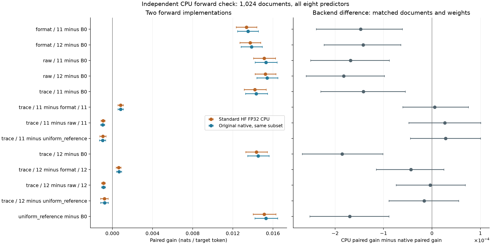

# Standard CPU verification of the matched pretrained models

**The negative matched-learning result survives independent standard CPU forwards.** Trace-minus-raw gains are **−0.000928 [−0.001137, −0.000736]** and **−0.000890 [−0.001086, −0.000711] nats/token** in the two source orders. Trace still beats format-only supervision, loses to the qualified ordinary reference, and improves over B0. For the critical trace-minus-raw contrasts, CPU-minus-native mean differences are only **+0.000027 / −0.000004**, with intervals spanning zero.

The standard Hugging Face FP32 implementation scored **1,024 fixed original documents for all eight frozen predictors**, making **8,192 actual CPU model forwards** and no additional accelerator calls. This checks numerical agreement on an inspected subset; the original 4,096-document native primary outcomes remain unchanged.

## Every original paired comparison

All gains below are **nats per original target token** over all 527 positions. CPU and native columns use exactly the same documents and trained model values. The last column isolates the difference between the two implementations' paired gains. Confidence intervals resample unique source documents, conditional on these fixed checkpoints.

| Comparison | Standard CPU gain | Native gain on same subset | CPU minus native paired gain |
|---|---:|---:|---:|
| scaffold_format-seed11 versus B0 | +0.0133697 [+0.0123342, +0.0143952] | +0.0135171 [+0.0124703, +0.0145551] | -0.0001473 [-0.0002388, -0.0000610] |
| scaffold_format-seed12 versus B0 | +0.0137253 [+0.0126974, +0.0147873] | +0.0138673 [+0.0128264, +0.0149319] | -0.0001420 [-0.0002229, -0.0000642] |
| scaffold_raw-seed11 versus B0 | +0.0151311 [+0.0140592, +0.0162578] | +0.0152993 [+0.0142191, +0.0164168] | -0.0001683 [-0.0002508, -0.0000883] |
| scaffold_raw-seed12 versus B0 | +0.0152399 [+0.0142231, +0.0162999] | +0.0154219 [+0.0143869, +0.0164853] | -0.0001820 [-0.0002600, -0.0000981] |
| scaffold_trace-seed11 versus B0 | +0.0142033 [+0.0131300, +0.0153194] | +0.0143448 [+0.0132704, +0.0154600] | -0.0001415 [-0.0002296, -0.0000549] |
| scaffold_trace-seed11 versus scaffold_format-seed11 | +0.0008336 [+0.0005589, +0.0011018] | +0.0008277 [+0.0005497, +0.0010995] | +0.0000058 [-0.0000603, +0.0000752] |
| scaffold_trace-seed11 versus scaffold_raw-seed11 | -0.0009278 [-0.0011367, -0.0007357] | -0.0009545 [-0.0011659, -0.0007587] | +0.0000268 [-0.0000479, +0.0001005] |
| scaffold_trace-seed11 versus uniform_reference | -0.0009352 [-0.0012583, -0.0006348] | -0.0009633 [-0.0012873, -0.0006655] | +0.0000281 [-0.0000448, +0.0001002] |
| scaffold_trace-seed12 versus B0 | +0.0143502 [+0.0132969, +0.0154425] | +0.0145357 [+0.0134844, +0.0156214] | -0.0001856 [-0.0002678, -0.0001015] |
| scaffold_trace-seed12 versus scaffold_format-seed12 | +0.0006248 [+0.0003799, +0.0008708] | +0.0006684 [+0.0004109, +0.0009184] | -0.0000436 [-0.0001150, +0.0000247] |
| scaffold_trace-seed12 versus scaffold_raw-seed12 | -0.0008898 [-0.0010862, -0.0007107] | -0.0008862 [-0.0010877, -0.0006909] | -0.0000035 [-0.0000739, +0.0000690] |
| scaffold_trace-seed12 versus uniform_reference | -0.0007883 [-0.0011744, -0.0004164] | -0.0007724 [-0.0011676, -0.0003987] | -0.0000159 [-0.0000889, +0.0000552] |
| uniform_reference versus B0 | +0.0151385 [+0.0140185, +0.0162965] | +0.0153081 [+0.0141929, +0.0164651] | -0.0001696 [-0.0002522, -0.0000889] |

The largest absolute mean difference between a paired CPU and native gain is **0.00018555 nats/token**. The largest individual-target log-probability discrepancy is **4.747785 nats**. Agreement of means does not establish identical per-token predictions. All final 16-token span results are separately retained in [the comparison table](all-paired-comparisons.csv).

## Inputs, precision and allocation

A source-identity ordered pool of 1,024 documents was fixed before CPU predictions, excluding the original 32-document CPU timing probe. Before any larger CPU call, the protocol selected the largest fixed prefix from 1,024, 768 or 512 documents that fit the measured runtime and 11:35 UTC deadline. The chosen size was **1024**, using only time and resource availability; no prediction score or scientific verdict chose the subset. Every model scores the same complete chosen set.

Models use their exact original BF16-representable values in a standard FP32/eager Hugging Face network. Gold-token normalization uses FP64 after ordinary FP32 logits. Each original 528-token window is unchanged; the network sees the first 527 tokens with normal causal attention and predicts all 527 subsequent targets. No calculation, special delimiter or teacher annotation enters these forwards. The shared base-weight loader is reused, while the forward implementation is the standard Transformers model rather than the native likelihood kernel. This remains within-repository verification, not an external training replication or a new independent confirmation population.

Two workers use 24 physical host cores each on NUMA node 1. The waiting source-mixture dispatcher was bound to its existing NUMA node 0 before fitting; this changes host placement, not its training recipe. The original 512 GiB available-host and 35 GiB filesystem floors remain enforced. The measured larger-check wall time is **5966.7 seconds**. No model is fitted, no checkpoint is selected, and no original criterion is replaced by this diagnostic.

The source-free archive preserves every original CPU FP64 target score and the exact corresponding native scores. An independent NumPy replay reconstructs all absolute scores and all 13 comparisons, including CPU/native differences and suffix results. Source text and source token IDs are omitted. [Readout](readout.json) · [Frozen allocation rule](prospective-design.json) · [Actual runtime decision](measured-go-no-go.json) · [Numerical reconstruction](independent-numerical-replay.json).
