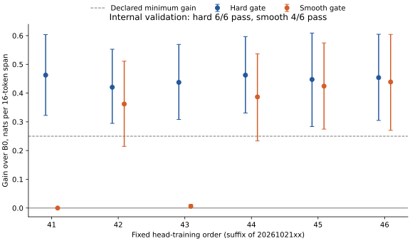

# Selector optimization: the proposed smooth-gate repair does not improve reliability

The original hard gate passes the practical criteria in **all six new head-training orders**. The calibrated smooth gate passes in **four of six**, with two nearly inactive runs. The prospective all-six smooth-gate criterion fails. This strengthens the selective-inference signal on an internal development split, while weakening the specific explanation that removing the hard cutoff is sufficient to stabilize learning.

This is a bounded CPU experiment over existing TRAIN caches. It is not fresh confirmation, a new backbone model, or a recovery of the failed continued-pretraining result.

## Comparison

Both gates start with the same parameters, calculation contribution (0.01), and local derivative (0.019701). The smooth gate has no intentional finite-logit dead region. All other optimization settings and document orders are paired. The same change is applied to the no-calculation ensemble control.

| Head-training order | Hard gate: gain versus B0 | Smooth gate: gain versus B0 |
|---|---:|---:|
| 2026102141 | +0.463 [+0.322, +0.604] | -0.000001 [−0.000005, +0.0000003] |
| 2026102142 | +0.420 [+0.295, +0.553] | +0.362 [+0.215, +0.511] |
| 2026102143 | +0.437 [+0.308, +0.569] | +0.006 [+0.001, +0.012] |
| 2026102144 | +0.462 [+0.331, +0.597] | +0.387 [+0.234, +0.536] |
| 2026102145 | +0.447 [+0.284, +0.609] | +0.424 [+0.275, +0.574] |
| 2026102146 | +0.454 [+0.305, +0.605] | +0.439 [+0.270, +0.604] |

Gains are nats per original 16-token calculation continuation, with paired 95% intervals. They are teacher-forced next-token likelihoods, not free-running answer accuracy. All six orders are reported; no checkpoint or seed was selected.

All six hard-gate heads also beat the FIT-trained global mixture, matched no-calculation head, and position-only schedule with positive lower confidence bounds. Their gains over the global mixture range from **+0.217 to +0.259 nats**; over the position schedule, **+0.157 to +0.199**. Smooth gates pass the primary comparisons in orders 42, 44, 45 and 46; only 45 and 46 beat the position schedule with a positive lower bound.

Every head meets the ordinary-text tolerance. All ordinary-cost point estimates are positive: hard gates cost **0.00105–0.00368 nats/token**, smooth gates **0.00039–0.00373**. This is retained quality within tolerance, not improved ordinary prediction. Calculation prevalence and a natural-corpus predictive gain remain unmeasured.

## What the failure diagnosis now supports

The two stalled smooth heads put at least 99% of calculation-token contributions below 0.001 and gain at most 0.01 nats/span. Their final data-gradient norms are approximately 7.2e-7 and 4.0e-9. Thus a gate without an intentional hard-zero region can still become effectively inactive. The calibrated sigmoid can saturate, and its geometry away from initialization differs from the hard gate. This experiment does not isolate a unique cause of stalling or establish that every smooth parameterization will fail.

The original hard gate succeeds in six orders here, but the earlier failed order is not reclassified. This study fits on 4,096 sources for 640 updates rather than the parent's 5,120 sources for 800 updates, and uses six new orders. Those shared changes prevent identifying why the original order 32 failed. The six heads use the same frozen model pair and overlap in fitting data; they are optimization repetitions, not six independent language-model replications.

Both sets of no-calculation heads remain mostly inactive (over 99.7% of calculation positions have contribution at most 0.001). Beating those implemented controls does not exhaust stronger ensemble methods. The separately fitted constant and position controls remain important, and all hard-gate heads beat both on this split.

## Protocol and verification

- Execution source: **10268da**, frozen before fitting. [Prospective design](../../configs/selector_optimization_train_v1.json), [freeze receipt](../selector_optimization_train_v1_freeze_20261021.json).
- Original 5,120 TRAIN sources split by source hash into **4,096 FIT / 1,024 internal validation**, balanced by calculation/ordinary kind. A fixed 256-source probe uses FIT only. The original TRAIN pool and earlier probes had already been used in development.
- **24 terminal heads**, hard/smooth × calculation/no-calculation × six orders; ten passes, 640 updates, batch 64, FP64 CPU AdamW. Every head froze before internal scoring. No new model calls, feature extraction, completed DEV reads or backbone updates.
- Each interval resamples **512 complete unique source documents** within its stratum, 5,000 times, with fixed seeds 2026102147/48. A document contributes its full 16-token score. Intervals are unadjusted and conditional on the fixed heads; they do not quantify training-run or development-selection uncertainty.
- Per-order primary requirements: calculation gain ≥0.25 with positive lower bound versus B0; positive lower bounds versus global mixture and matched no-calculation head; ordinary cost upper bound ≤0.03 nats/token. All six smooth orders were required for the prospective development go-signal. Position-only comparison is secondary.
- Independent NumPy reconstruction agrees with all 24 heads' target probabilities, routing, absolute scores, intervals and decisions. It shares the original cache loader and source-split definition; it is not an external replication. A separate source-free replay checks published document scores, routing and decisions without Torch or model calls.
- All **1,979 CPU tests**, smoke and compilation checks passed before fitting. The study and original-cache reconstruction took **215.82 + 13.19 seconds on four CPU cores**, using **9.01 MiB** of study output and **zero accelerator chip-hours**. Packaging and tests are separate from those timings.

[All-order CSV](all-orders.csv) · [Original readout](readout.json) · [Frozen heads and fitted controls](frozen-heads-and-controls.json) · [Independent reconstruction](independent.json) · [Source-free replay](public-replay.json) · [Runtime](runtime.json)

## Consequence for the research direction

Retain the repeated internal selective-inference result and the failed smooth-gate repair together. Do not select a successful seed, overwrite the parent's failed joint criterion, or interpret this as improved pretrained weights or autonomous discovery. The next empirical step needs a fixed recipe, untouched sources and an explicit mixture/prevalence target; it should also retain strong constant, position and no-calculation controls. A broad CPT sweep or writer RL does not follow from this study. Before another CPT claim, qualify a genuinely uniform next-token baseline separately.

A separate [read-only precision review](../executed_precision_review_20261021.json) found that the installed compiler defaults `--auto-cast` to `none`. Omission of the flag does not establish the reviewer's proposed BF16-by-default explanation. Existing numerical discrepancies and owner-approved exceptions remain recorded; their cause is unresolved. This CPU study inherits the frozen caches and does not requalify them.
