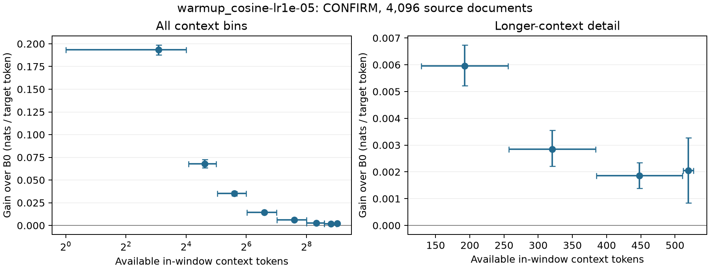

# Uniform next-token baseline: four fixed settings

The selected checkpoint improves full-window held-out prediction; the declared baseline criterion passes. The DEV-selected recipe is **Cosine / 1e-5**, using its original terminal update 128 checkpoint. This is ordinary continued pretraining; there is no thought supervision, selector or writer policy in this study.

## Confirmation result

On 4,096 source-separated confirmation documents, full-window NLL is **1.443585** for untouched B0 and **1.429104** for the selected checkpoint. The paired improvement is **+0.014481 [+0.013903, +0.015058] nats per token** over all 527 target positions. Positive means better prediction. The perplexity ratio to B0 is **0.985623**, where a ratio below one is better, on this population.

The final 16-token improvement on these same natural windows is separately **+0.032717 [+0.013546, +0.052275] nats per span**. The previously inspected calculation panel gives **+0.021967 [-0.010545, +0.054757] nats per 16-token continuation**, on 1,024 sources. That calculation result is diagnostic, not fresh confirmation.

## Every development setting

All four terminal checkpoints were fixed before scoring DEV. The rule selected the lowest DEV mean full-window NLL; exact ties prefer the lower learning rate, then lexical recipe name. The chosen existing checkpoint and its hash were frozen before confirmation. These DEV intervals are exploratory because DEV selects the recipe.

| Terminal recipe | DEV full-window NLL | Gain over B0, nats/token [95% CI] | Final 16-token gain, nats |
|---|---:|---:|---:|
| Untouched B0 | 1.433853 | Reference | Reference |
| Constant / 1e-5 | 1.419318 | +0.014535 [+0.013177, +0.015965] | +0.029178 |
| Constant / 3e-6 | 1.420239 | +0.013614 [+0.012825, +0.014410] | +0.053645 |
| Cosine / 1e-5 | 1.418918 | +0.014935 [+0.013865, +0.016055] | +0.048286 |
| Cosine / 3e-6 | 1.422276 | +0.011577 [+0.010896, +0.012263] | +0.030524 |

## Training and source population

Every recipe starts afresh from Qwen3-1.7B-Base and sees the same 32,768 original FineMath windows once, in source order seed 11: **17,268,736 target tokens**, 128 optimizer updates, global batch 256, eight ranks, microbatch four and accumulation eight. All 527 shifted targets in each 528-token original window have equal coefficient. There is no duplicated suffix, auxiliary objective or inserted formatting. AdamW uses FP32 masters and moments, BF16 parameters and gradients, clipping at one, betas (0.9, 0.95), epsilon 1e-8 and weight decay 0.1. Each setting has 13 warmup updates; cosine ends at one-tenth peak LR. Native compiler auto-cast is explicitly disabled.

The four settings are two peak LRs (3e-6, 1e-5) crossed with constant/cosine schedules. They are **four optimization settings, not four training replications**. All 38,912 TRAIN/DEV/CONFIRM/qualification windows were independently checked against pinned source records before execution. Selection used source identity and length, not arithmetic enrichment or model outcomes. The population is the declared source-clean, eligible FineMath window frame, not all language and not material proven absent from B0 pretraining.

## Numerical checks and resources

The complete four-update native check and full-state recovery pass. Initial native loss differs from the fixed CPU reference by 0.000678694 nats/token. Actual learning rates, one gradient reduction per accumulated update, finite FP32-master changes and replica agreement pass. Updates three/four, every terminal model tensor and all optimizer shards reproduce exactly after restoring update two. All model, master and moment values inspected in that qualification are finite.

An earlier exact-recovery check failed: its fourth-update loss differed by 0.00001633 nats/token despite exact state loading. Equal restored counters shared one device-data-cache input. The restore path now disables that cache only during state transfer/materialization and restores its previous setting afterward. The original strict failure remains in the readout; the repaired path passed the same bitwise requirement before fitting.

The separate full-window B0 scoring check differs from CPU by 0.000674747 nats/token on the first qualification batch, within the fixed 0.02 tolerance. All eight actual model signatures agree. Qualification sources are excluded from fitting, development and confirmation.

Actual reservations total **16.607276 chip-hours**, below the unchanged **18** assigned-chip-hour ceiling. Each job uses two physical chips. The owner authorized running the remaining independent configurations concurrently, using up to six chips while preserving every numerical recipe. These totals count the assigned job pairs; they are not the whole 16-chip node's elapsed reservation or an invoice. Training accounts for 11.658595, scientific scoring 0.510187, and qualification plus all unsuccessful reservations 4.438494. First-use compilation, disk and wall-bound stops remain in the attempt records and totals. CPU-only compilation and numerical reconstruction are distinct from accelerator reservations. No numerical exception was needed for this qualification.

To preserve both the original failed qualification and the new reference/replay states, the full-checkpoint workspace on the existing RAM filesystem increased from the proposed 180 to 256 GiB. The 35 GiB free-disk and 512 GiB available-host-memory floors and the 18-chip-hour ceiling remain unchanged.

## Statistics, replay and interpretation

Every paired comparison resamples **unique source documents**, carrying all 527 token scores together: 5,000 percentile bootstrap draws, seed 17, using the central production helper. Confidence intervals describe document sampling conditional on fixed checkpoints; they do not measure training-order or model uncertainty. No intermediate checkpoint was selected by DEV and no confirmation outcome chose a recipe.

The source-free archive preserves every original native evaluation token log probability exactly and includes all four original per-update training histories. A standalone NumPy replay reconstructs absolute scores, all six paired comparisons, the DEV choice and the confirmation decision. Its integrity tests reject altered verdicts, intervals, resampling units, selection and score hashes. These are numerical checks within the repository, not an external training replication or verification of source text omitted from that archive.

This result qualifies or rejects this bounded ordinary-training reference. It does not establish an effect of thought supervision, internalized computation or autonomous discovery. Full-window prediction, final-continuation prediction and the older calculation diagnostic remain separate measurements. The fixed search does not exhaust ordinary pretraining methods.

Scientific source commit: `4f9166b944fcc3a7e38df6f32bd45b396d5047ef`. Full states and all four terminal model files are retained outside Git. The prospective scheduling amendment is included in the readout. See [complete readout](readout.json), [all scores and comparisons](absolute-and-paired-results.csv), [hardware qualification](native-qualification.json), [budget projection](measured-budget.json) and [numerical replay](independent-numerical-replay.json).

## Subsequent standard CPU forward diagnostic

After completing the fixed study, a new identity-selected 32-document subset of its completed confirmation panel was checked with standard Hugging Face FP32 CPU forwards and FP64 target-log-probability normalization. Both B0 and the selected checkpoint use their original exact BF16-representable parameter values. The mean paired gain is **0.012699 nats/token on CPU versus 0.012784 natively**, a mean difference of **0.0000844**. The largest per-document paired-gain discrepancy is **0.002059** nats/token. The largest individual-token log-probability discrepancy is **1.422697 nats**: aggregate agreement does not imply tokenwise equality. Both aggregate checks meet their diagnostic thresholds fixed before these CPU calls. The 64 forwards took 111 seconds, with no new accelerator use. This is numerical follow-up on an inspected subset, not new confirmation, checkpoint selection or external replication. [Full diagnostic](../uniform_lm_cpu_forward_check_20261022.json).

## Where the baseline gain occurs

An exploratory decomposition of the original 4,096-document confirmation scores finds **69.5% of the total gain in the first 64 of 527 target positions**. Gain declines from **0.1934 nats/token** with 1–16 in-window context tokens to **0.00205** on the final 16 targets. It remains positive over the 399 targets after context length 128, averaging **0.00350 nats/token**. The bin widths reconstruct the original full-window mean exactly. These are different targets at different positions, so this decomposition alone does not identify context as the cause or distinguish vocabulary adaptation from learned procedures. [Original-score decomposition](context-position-gains.json).

A separate exploratory CPU truncation check uses the **same final 16 target tokens** in the same fixed 32-document subset at every condition. With only one preceding token, the trained-minus-B0 gain is **+2.459 nats/span [1.615, 3.444]**; with 16 preceding tokens it is **+0.982 [0.512, 1.453]**. At 64, 128 and 512 preceding tokens, the small-subset intervals include zero. The paired difference between the one-token and 512-token conditions is **+2.519 [1.740, 3.410]**. Normal positions reset after truncation, so both accessible history and position change. The 512-token scores agree with the earlier full-window CPU check within 0.0000174 nats/span. These 320 CPU forwards took 127 seconds, with no accelerator use.

This check supports a substantial short-context component to this baseline's improvement. It does not overturn the positive full-population suffix result, establish a causal internal mechanism, or supply fresh confirmation of a selected checkpoint. All five conditions and four paired interactions are retained. [Plan](controlled-context-plan.json) · [Readout](controlled-context-readout.json) · [Original source-free scores](controlled-context-original-scores.jsonl).
