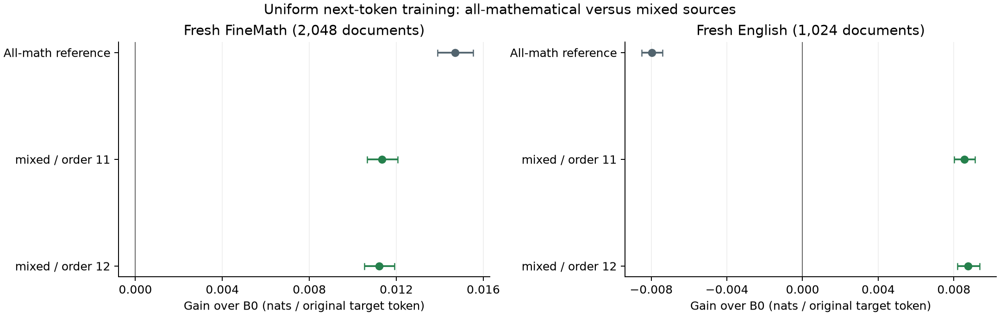

# Ordinary continued pretraining with source replay

The fixed two-order criterion **passes**. Improvement over B0 in both fresh domains for both source orders is **established**. Improvement over the qualified all-FineMath reference on the declared equal-domain target in both orders is **established**. This is ordinary next-token training, not thought supervision or autonomous learning.

## Fresh results

All terminal checkpoints were fixed before either fresh confirmation cohort was scored. The mathematical panel has 2,048 documents; the educational-English panel has 1,024. Each contributes all 527 original shifted targets. Positive gain means better prediction, in nats per token.

| Fixed model | Fresh FineMath gain, nats/token [95% CI] | Fresh English gain, nats/token [95% CI] |
|---|---:|---:|
| uniform_reference | +0.014699 [+0.013889, +0.015531] | -0.007959 [-0.008495, -0.007412] |
| mixed-seed11 | +0.011346 [+0.010659, +0.012064] | +0.008550 [+0.008015, +0.009106] |
| mixed-seed12 | +0.011204 [+0.010533, +0.011917] | +0.008756 [+0.008191, +0.009363] |

Absolute negative log likelihood, lower is better:

| Model | FineMath full-window NLL | English full-window NLL |
|---|---:|---:|
| B0 | 1.433710 | 2.489419 |
| uniform_reference | 1.419011 | 2.497378 |
| mixed-seed11 | 1.422364 | 2.480869 |
| mixed-seed12 | 1.422506 | 2.480663 |

The all-mathematical reference retains the best mathematical score in this comparison. Mixing sources gives up approximately **0.00335 / 0.00350 nats/token** of its mathematical gain while reversing its English regression. Both mixed models still improve on B0 in each domain; they are not improvements over the reference on every individual domain.

The primary criterion requires a positive lower confidence bound for each mixed order against B0 in each domain, plus a positive lower bound against the qualified reference on a fixed 50/50 target. No order or checkpoint is discarded. Passing only a weighted target would not establish improvement in both domains.

## Declared target and final continuations

The target weights the two domain means equally, regardless of their different sample counts. It is a specified research distribution, not an estimate of natural corpus prevalence. Confidence intervals combine independent document-bootstrap draws from the two strata.

| Source order | 50/50 target gain versus B0 | 50/50 target gain versus qualified reference |
|---|---:|---:|
| 11 | +0.009948 [+0.009509, +0.010413] | +0.006578 [+0.006241, +0.006926] |
| 12 | +0.009980 [+0.009532, +0.010456] | +0.006610 [+0.006240, +0.006989] |

Final 16-token improvements are separate, in nats per span; they do not substitute for full-window prediction:

| Fixed model | FineMath final16 gain, nats/span | English final16 gain, nats/span |
|---|---:|---:|
| uniform_reference | +0.039947 [+0.015181, +0.064567] | -0.059860 [-0.094974, -0.024407] |
| mixed-seed11 | +0.024567 [+0.001380, +0.047886] | +0.027085 [-0.005154, +0.060567] |
| mixed-seed12 | +0.025617 [+0.000239, +0.051030] | +0.042361 [+0.008170, +0.077018] |

## One change: training sources

Each fresh Qwen3-1.7B-Base model sees 16,384 original FineMath windows and 16,384 original FineWeb-Edu windows once. All 528-token windows retain every original token and give all 527 shifted targets equal coefficient **1/(256×527)**. There are no inserted thought delimiters, generated notes, auxiliary branches, duplicated suffixes or selected answer targets. The 50/50 fitting objective follows directly from equal source counts and lengths.

The already-qualified schedule is unchanged: 128 optimizer updates, global batch 256, eight ranks, microbatch four, accumulation eight, 13 warmup updates, peak LR 1e-5 and cosine decay to one-tenth peak. AdamW uses clipping one, betas (0.9,0.95), epsilon 1e-8 and weight decay 0.1. Parameters/gradients are BF16, masters/moments and CE FP32, with compiler auto-cast explicitly disabled. Each order receives **17,268,736 source targets**. Source orders 11 and 12 are fixed, sharing one base checkpoint and one corpus; these are not independent pretraining trajectories.

The mathematical fitting half is an exact identity-selected subset of the prior verified baseline training cohort. The qualified reference saw all 32,768 mathematical windows with the same token budget and numerical schedule. Thus the intervention changes source composition and mathematical exposure; it does not isolate a new optimizer or algorithm.

## Prospective sources and execution

Both fitting protocols froze at **05:05 UTC**, before scaffold confirmation outcomes. The source intervention was chosen after observing that the four original FineMath recipes regress on the earlier English diagnostic. Neither new confirmation cohort has those sources. Models start from B0, not from a selected intermediate checkpoint. There is no new development-set search.

All 35,840 fitting/confirmation sources are separated. Independent verification reconstructs 17,408 new English windows and 2,048 fresh mathematical windows from pinned original Parquet records; the 16,384 mathematical fitting windows exactly match the earlier independently verified parent. English comes from a fixed 36,864-record frame in one [FineWeb-Edu](https://huggingface.co/datasets/HuggingFaceFW/fineweb-edu) shard, excluding known mathematical pages/content and the prior English diagnostic. FineMath confirmation follows identity/length-only selection from the remaining bounded source-clean frame. No arithmetic success or model outcome selects or replaces a row. These populations are not all language, and base-pretraining novelty is unproven.

The unchanged numerical source **4f9166b944fcc3a7e38df6f32bd45b396d5047ef** reuses the baseline's actual accumulation and exact full-state recovery qualification. That shared qualification cost was charged in the original baseline, not counted twice here. The scoring wrapper binds the unchanged original likelihood worker, source roles, independent receipts, checkpoint hashes and all required terminals before either cohort is scored. The outer scoring source is **112f1e77c543ad89db9abe8f1aa7dc88c4d4e40e**. All 2,069 relevant CPU tests, smoke and compilation pass; CPU tests are distinct from native qualification.

Execution follows closure of the main scaffold study and a measured time/storage go decision, independent of its scientific verdict. Actual additional assigned reservations total **6.290836 chip-hours**, including every attempt: fitting 5.854949, scoring 0.435887, within the fixed 7.5 ceiling. At most two existing two-chip trainers run concurrently. Full models, optimizer states and original evidence remain retained; 35 GiB filesystem and 512 GiB available-host floors are unchanged. A 39 GiB final RAM-filesystem forecast is required before release. Assigned reservations are not the whole-node invoice or a FLOP-efficiency measure.

## Statistics and scope

Each paired comparison resamples unique source documents with all 527 token scores together: 5,000 percentile-bootstrap draws, seed 17 for mathematics and 19 for English. The independent streams produce the 50/50 target interval by summing equally weighted draws. Confidence intervals describe document sampling conditional on these fixed checkpoints; they do not capture all training or development uncertainty. The two orders are reported separately.

The public archive preserves every native FP32 target score exactly and both original 128-update histories. A standalone NumPy reconstruction checks all 15 domain/target comparisons and the unchanged decision. Integrity fixtures reject altered scores, histories, intervals, resampling units, fixed models, mixture weights and verdicts. This is numerical verification within the repository, not an external model replication or verification of source text omitted from the public archive.

The completed result supports a better ordinary reference on the declared two-domain target under this fixed budget. It does not isolate an effect of intermediate supervision, internalized computation or autonomous discovery. The stronger reference is produced by ordinary data composition, while the separate matched computation-supervision criterion remains failed. See [complete readout](readout.json), [all comparisons](all-paired-contrasts.csv), [absolute scores](absolute-scores.csv) and [numerical replay](independent-numerical-replay.json).

## Independent CPU forward diagnostic

A separately fixed check scores all four predictors on 32 identity-selected documents per domain, with 256 standard CPU forwards and no accelerator calls. Both domain checks pass their predefined aggregate-difference thresholds. The largest mean paired-gain discrepancies are **0.001002 nats/token on Math** and **0.000221 on English**; largest document discrepancies are 0.009046 / 0.004017. Individual-token log-probability discrepancies reach **2.0051 / 1.6757 nats**, so this is not a tokenwise-equality claim. All thresholds and identities were fixed before the mixture confirmation or CPU results. This checks numerical behavior on inspected subsets, while the original fresh native decisions remain unchanged. [Complete checks, including all controls](../uniform_mixture_CPU_forward_check_20261022.json).
